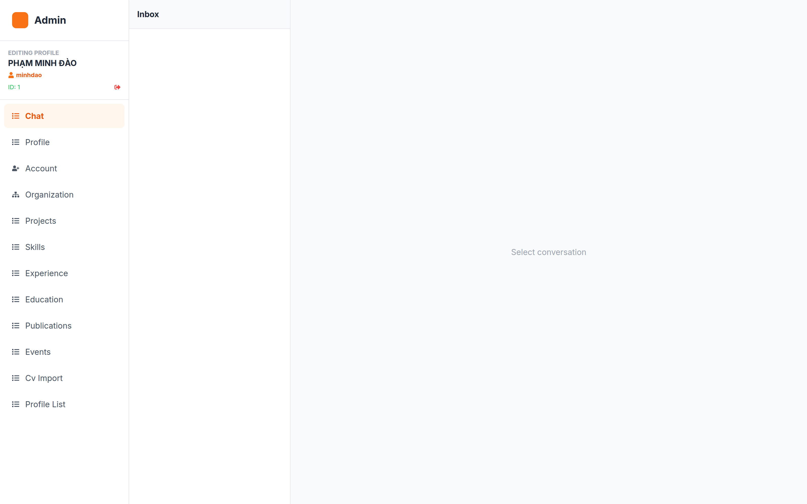
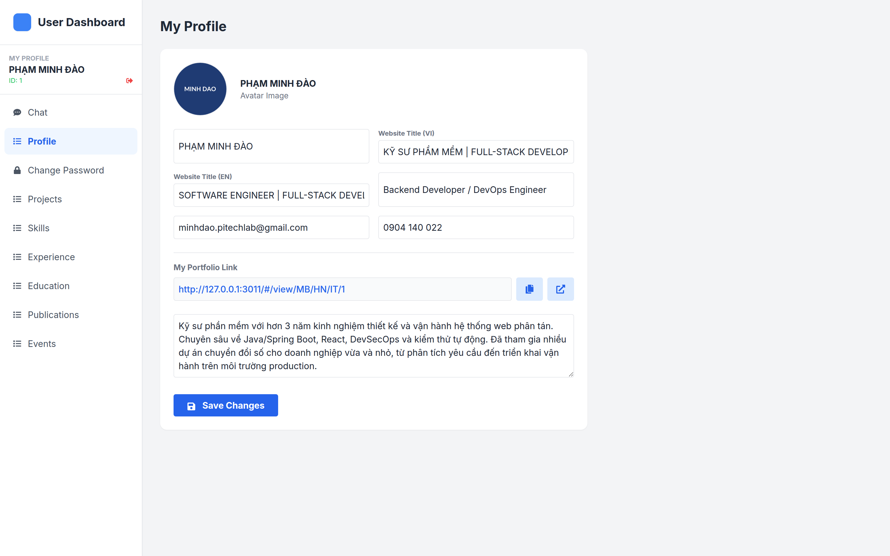
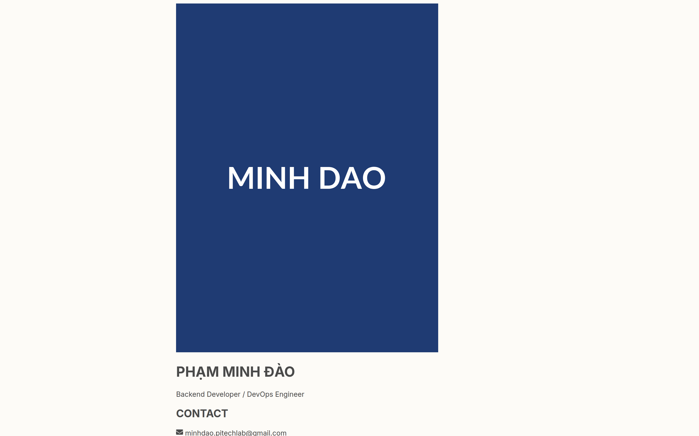

# 01 — TỔNG QUAN HỆ THỐNG

> **Hệ thống:** PITECH LAB — Dynamic Portfolio (CV Profile Platform)
> **Phạm vi:** Frontend React 19 + Vite 6 (TypeScript)
> **Mã nguồn:** `https://github.com/dao24092004/pitechlab-cv-profile.git` @ `main` (`886de4b`)

---

## 1. Mục đích và phạm vi nghiệp vụ

### 1.1. Bài toán

Tổ chức PITECH LAB / INNOTECH SOLUTIONS cần một nền tảng để:

1. **Trình bày hồ sơ năng lực (portfolio/CV) của từng nhân sự** theo hình thức trang web cá nhân, có bản in ra CV.
2. **Quản lý dữ liệu hồ sơ tập trung** — quản trị viên (Admin) nhập liệu và duyệt kích hoạt (publish) hồ sơ.
3. **Phân quyền theo tổ chức** — mỗi hồ sơ được gắn với một vị trí trong cây tổ chức 3 cấp, dùng làm đường dẫn chia sẻ.
4. **Kết nối trực tiếp với người xem** — khách truy cập trang portfolio có thể chat và gọi video với quản trị viên ngay trên trang.

### 1.2. Phạm vi

| Thuộc tính | Trong phạm vi | Ngoài phạm vi |
|---|---|---|
| Lớp trình bày (React) | ✅ | |
| Định tuyến, phân quyền phía client | ✅ | |
| Lớp giao tiếp REST/STOMP (client) | ✅ | |
| Đặc tả nghiệp vụ phía server | | ❌ (repo riêng) |
| Thiết kế CSDL | | ❌ |
| Hạ tầng triển khai, CI/CD, monitoring | | ❌ |
| Tích hợp Cloudinary (upload ảnh) | Ghi nhận điểm giao tiếp | Không đặc tả |

### 1.3. Thuật ngữ

| Thuật ngữ | Ý nghĩa |
|---|---|
| **Profile / Hồ sơ** | Bản thông tin portfolio của một nhân sự — thực thể trung tâm của hệ thống. |
| **Active / Published** | Trạng thái hồ sơ được công khai. `POST /admin/profile/{id}/activate`. |
| **Region / Vùng** | Cấp 1 tổ chức (VD: Miền Bắc), mã riêng (VD: `MB`). |
| **Local Org / Chi nhánh** | Cấp 2, thuộc một Vùng, mã riêng (VD: `HN`). |
| **Department / Phòng ban** | Cấp 3, thuộc một Chi nhánh, mã riêng (VD: `IT`). |
| **Visitor / Khách** | Người dùng ẩn danh xem trang portfolio, có thể chat/gọi video. |
| **CV Import** | Tính năng nhập file CV (`.pdf`/`.docx`) để backend tự động sinh hồ sơ (AI parsing). |

---

## 2. Kiến trúc tổng thể

### 2.1. Sơ đồ khối hệ thống

```
┌──────────────────────────────────────────────────────────────────────┐
│                          TRÌNH DUYỆT KHÁCH                          │
│  Trang Portfolio công khai  +  ChatWidget  +  VideoCallInterface    │
│  (pages/Home.tsx)              (khách ẩn danh)     (WebRTC client)  │
└───────────────┬──────────────────────────┬───────────────────────────┘
                │ REST (Axios)             │ STOMP / SockJS
                │ Bearer token (nếu có)    │ /topic/private/{visitorId}
                ▼                          ▼ /app/chat.sendToAdmin
┌──────────────────────────────────────────────────────────────────────┐
│                    BACKEND SPRING BOOT (repo riêng)                  │
│  REST: /api/v1/{portfolio,admin,user,auth,org,upload,export}       │
│  STOMP: /app/chat.*  /app/video.*  →  /topic/*                      │
│  Storage: ảnh tải lên (URL trả về dạng đường dẫn tương đối)        │
└──────────────────────────────────────────────────────────────────────┘
                ▲                          ▲
                │ REST + STOMP              │
┌───────────────┴──────────────────────────┴───────────────────────────┐
│                     TRÌNH DUYỆT QUẢN TRỊ                           │
│  pages/Admin.tsx  (12 tab)      pages/User.tsx  (9 tab)              │
│  Quản lý hồ sơ, tổ chức, chat, gọi video, nhập CV                  │
│  pages/Login.tsx  →  Bearer token trong localStorage                │
└──────────────────────────────────────────────────────────────────────┘
```

### 2.2. Kiến trúc phần mềm phía client

Frontend dùng kiến trúc **SPA (Single Page Application)** với 3 tầng rõ rệt:

```
┌─────────────────────────────────────────────────────────────────┐
│ TẦNG TRÌNH BÀY (pages/, components/)                            │
│  Home · Admin · User · Login                                    │
│  Component tái sử dụng: Header, ChatWidget, VideoCallInterface,  │
│  ProjectModal, ZigZagSection, PortfolioPrintTemplate, ...       │
└───────────────────────┬─────────────────────────────────────────┘
                        │ gọi qua service layer
┌───────────────────────▼─────────────────────────────────────────┐
│ TẦNG DỊCH VỤ (services/api.ts)                                 │
│  • portfolioService — đọc dữ liệu portfolio (công khai)          │
│  • adminService    — CRUD quản trị, upload, tổ chức               │
│  • userService     — CRUD cá nhân, đổi mật khẩu                   │
│  • Axios instance + interceptor (Bearer token, Accept-Language)   │
│  • mapBackendToFrontend() — chuẩn hóa response backend → FE      │
└───────────────────────┬─────────────────────────────────────────┘
                        │ kiểu dữ liệu
┌───────────────────────▼─────────────────────────────────────────┐
│ TẦNG MÔ HÌNH (types/index.ts)                                   │
│  PortfolioData · Project · Skill · WorkExperience · Education    │
│  ChatMessage · Region · LocalOrg · Department                    │
└─────────────────────────────────────────────────────────────────┘
```

**Điểm thiết kế đáng chú ý:** không có state manager toàn cục (Redux/Zustand). State phân bố theo `useState` cục bộ trong từng trang, chuyển dữ liệu qua `services/api.ts`. Điều này đơn giản hóa triển khai nhưng khiến việc đồng bộ giữa các tab trong cùng trang phải gọi lại API thủ công (`reloadProfileData()`).

### 2.3. Bảng công nghệ

| Lớp | Công nghệ | Phiên bản | Vai trò |
|---|---|---|---|
| UI framework | React | 19.2.3 | Render, hooks, `StrictMode` |
| Build tool | Vite | 6.2.0 | Dev server (port 3000), build production |
| Ngôn ngữ | TypeScript | ~5.8.2 | Kiểu dữ liệu, `noEmit` (chỉ kiểm tra) |
| Routing | react-router-dom | 7.11.0 | `HashRouter` + route bảo vệ |
| HTTP client | axios | 1.13.2 | REST API, interceptor |
| Animation | framer-motion | 12.23.26 | Motion, `useScroll`, `useSpring`, variants |
| 3D | three + @react-three/fiber + drei | 0.182 / 9.5 / 10.7 | Nền 3D hero (`TechScene`) |
| Realtime | @stomp/stompjs + sockjs-client | 7.2.1 / 1.6.1 | STOMP qua WebSocket |
| WebRTC | API trình duyệt (native) | — | Gọi video P2P |
| Icon | react-icons | 5.5.0 | Bộ icon Font Awesome |
| CSS | Tailwind CSS | (CDN + config) | Utility-first, dark mode `class` |
| In ấn | react-to-print | 3.2.0 | Xuất CV ra PDF |
| Toast | react-hot-toast | 2.6.0 | *(khai báo, chưa dùng)* |

---

## 3. Cấu trúc mã nguồn

### 3.1. Cây thư mục

```
pitechlab-cv-profile/
├── App.tsx                    # Định tuyến + ProtectedRoute
├── index.tsx                  # Entry point, mount React
├── index.html                 # Shell HTML, importmap ESM, Tailwind CDN
├── index.css                  # Tailwind directives + utility 3D
├── metadata.json              # Metadata app (AI Studio)
├── package.json               # Script & dependency
├── vite.config.ts             # Cấu hình Vite, alias '@', define process.env
├── tsconfig.json              # TS config, alias '@/*'
├── tailwind.config.js         # Theme "canva-*", darkMode: 'class'
│
├── pages/
│   ├── Home.tsx       (633 dòng)  # Trang portfolio công khai
│   ├── Admin.tsx      (876 dòng)  # Bảng điều khiển quản trị
│   ├── User.tsx       (507 dòng)  # Bảng điều khiển cá nhân
│   └── Login.tsx      ( 98 dòng)  # Đăng nhập
│
├── components/
│   ├── Header.tsx               (106)  # Header + nav + đổi ngôn ngữ
│   ├── ChatWidget.tsx           (160)  # Chat khách truy cập
│   ├── VideoCallInterface.tsx   (263)  # Gọi video WebRTC
│   ├── PortfolioPrintTemplate.tsx(171) # Mẫu in CV A4
│   ├── ZigZagSection.tsx        (225)  # Danh sách dự án so le
│   ├── ProjectModal.tsx         (217)  # Modal chi tiết dự án
│   ├── TechScene.tsx            (139)  # Nền 3D hero
│   ├── ImageViewer.tsx          (143)  # Xem ảnh gallery
│   ├── CustomCursor.tsx         (114)  # Con trỏ tùy biến
│   ├── ProjectCarousel.tsx      ( 54)  # Carousel dự án (không dùng ở Home)
│   ├── TextReveal.tsx           ( 67)  # Hiệu ứng hiện chữ
│   ├── SkillFlipCard.tsx        ( 46)  # Thẻ kỹ năng lật 3D
│   ├── LanguageSwitcher.tsx     ( 55)  # *(không dùng)*
│   ├── MagneticWrapper.tsx      ( 42)  # Hiệu ứng "nam châm" theo chuột
│   ├── DarkModeSwitch.tsx       ( 40)  # Công tắc sáng/tối
│   ├── AvatarBox.tsx            ( 44)  # Avatar nghiêng 3D
│   ├── ThreeScene.tsx           ( 25)  # Sphere biến dạng (không dùng)
│   └── Avatar3D.tsx             ( 21)  # Avatar khung mềm
│
├── services/
│   └── api.ts                   (269)  # Axios + 3 service + mapper
│
├── types/
│   └── index.ts                 (104)  # Interface TypeScript
│
├── utils/
│   └── translations.ts          (110)  # Bản dịch VI/EN tĩnh
│
└── docs/                        # ← Bộ tài liệu bàn giao (mới)
```

### 3.2. Quy ước đặt tên

| Loại | Quy ước | Ví dụ |
|---|---|---|
| Component | PascalCase + `.tsx` | `ProjectModal.tsx` |
| Trang | PascalCase trong `pages/` | `Home.tsx` |
| Hook/service | camelCase | `portfolioService`, `useTranslation` |
| Hằng số | UPPER_SNAKE | `API_BASE_URL`, `PAGE_SIZE` |
| CSS class | Tailwind utility | `bg-slate-900/40 backdrop-blur-xl` |

### 3.3. Quy ước mã nguồn đang áp dụng

- **Tiếng Anh cho tên biến/hàm**, tiếng Việt cho chuỗi hiển thị người dùng và comment.
- Comment giải thích *ý nghĩa* không phải *cú pháp*; nhiều comment được đánh dấu bằng emoji (🔥, 👇, ⚠️).
- **Alias `@/`** trỏ về thư mục gốc project (`vite.config.ts` + `tsconfig.json`).
- **Component không có PropTypes** — dùng interface TypeScript.
- `any` được dùng rộng rãi ở các vị trí dữ liệu chưa chuẩn hóa (education, publication, event).

---

## 4. Mô hình dữ liệu phía client

### 4.1. Thực thể chính: `PortfolioData`

```typescript
interface PortfolioData {
  id?: number;
  fullName: string;
  titleVi?: string;        // Tiêu đề trang (VI) — hỗ trợ "|" để ngắt dòng
  titleEn?: string;        // Tiêu đề trang (EN)
  username?: string;       // Tên đăng nhập đã gán cho hồ sơ
  jobTitle: string;
  bio: string;
  avatarUrl: string;
  strengths?: string;
  workStyle?: string;
  contact: Contact;        // { email, github, linkedin, location, phone? }
  projects: Project[];
  skills: Skill[];
  workHistory: WorkExperience[];
  education: Education[];
  events?: any[];
  publications?: any[];
  regionName?: string;     // Tổ chức cấp 1
  localOrgName?: string;   // Tổ chức cấp 2
  departmentName?: string; // Tổ chức cấp 3
  departmentId?: number;
}
```

### 4.2. Các thực thể con

| Interface | Trường chính | Ghi chú |
|---|---|---|
| `Contact` | `email, github, linkedin, location, phone?` | |
| `Project` | `id?, title, description, imageUrl, gallery?, technologies[], demoUrl?, repoUrl?, role?, customer?` | `technologies` là mảng string; backend trả `techStack` dạng chuỗi phân tách bởi dấu phẩy |
| `Skill` | `id?, name, proficiency (0–100), category?` | `category` ∈ {Backend, Frontend, Database, DevOps, Scientific} |
| `WorkExperience` | `id?, company, role, startDate, endDate, description, isCurrent?` | `isCurrent` → hiển thị "Present" |
| `Education` | `id?, school, degree, year, description?` | Mapper đọc `e.period` → `year`, `e.startDate`/`e.endDate` |
| `ChatMessage` | `id?, sender, content, timestamp, type` | `type` ∈ {CHAT, JOIN, LEAVE}; thực tế còn dùng `senderId`, `recipientId` |
| `Region` | `id, name, code` | |
| `LocalOrg` | `id, name, code, regionId, regionName` | |
| `Department` | `id, name, code, localOrgId, localOrgName` | |

### 4.3. Lớp chuẩn hóa: `mapBackendToFrontend()`

Điểm then chốt của lớp dịch vụ. Backend trả về tên trường **không đồng nhất** với mô hình client; hàm này ánh xạ lại:

| Backend trả về | Client nhận | Ghi chú |
|---|---|---|
| `data.userName` | `username` | |
| `data.contact.address` | `contact.location` | |
| `data.contact.phone` | `contact.phone` | Có thể `undefined` |
| `p.name \|\| p.nameVi \|\| p.nameEn` | `projects[].title` | Chuỗi fallback |
| `p.description \|\| p.descriptionVi \|\| p.descriptionEn` | `projects[].description` | |
| `p.techStack` (chuỗi) | `projects[].technologies[]` | Tách bẟi `,` |
| `p.sourceCodeUrl` | `projects[].repoUrl` **và** `sourceUrl` | Nhân đôi có chủ đích |
| `w.companyName` | `workHistory[].company` | |
| `w.position` | `workHistory[].role` | |
| `e.period` | `education[].year` | |
| `e.startDate`, `e.endDate` | `education[].startDate/endDate` | Giữ thêm |
| `pub.link \|\| pub.url` | `publications[].url` | |
| `e.name` | `events[].name` | |

**Xử lý URL ảnh** — `resolveImageUrl()`:

```
null/undefined  → https://placehold.co/600x400?text=No+Image
bắt đầu "http"  → giữ nguyên (URL tuyệt đối)
còn lại          → ${API_BASE_URL}${"/" + path}   (URL tương đối từ backend)
```

**Giá trị mặc định khi thiếu:** `strengths → "Problem Solving"`, `workStyle → "Professional"`, `contact.location → "Unknown"`, `workHistory.startDate → "N/A"`, `endDate → "Present"`.

---

## 5. Mô hình phân quyền

### 5.1. Vai trò và quyền


<!--SHOT-DONE:<!--SHOT:admin-->-->


**Bảng điều khiển quản trị — màn hình hộp thư chat**

> Khung bên trái là 12 nhóm chức năng quản trị, khung bên phải hiển thị nội dung theo tab đang chọn (mặc định là Chat). Đây là nơi quản trị viên trả lời tin nhắn và tiếp nhận cuộc gọi video của khách truy cập.


<!--SHOT-DONE:<!--SHOT:user-->-->


**Bảng điều khiển người dùng — trang tự quản lý hồ sơ**

> Mỗi nhân sự có vùng quản lý riêng gồm 9 tab: hồ sơ, dự án, kỹ năng, kinh nghiệm, học vấn, công bố, sự kiện, đổi mật khẩu và đăng xuất.


| Vai trò | Biến `role` trong localStorage | Đường dẫn | Quyền |
|---|---|---|---|
| **Khách ẩn danh** | (không có) | `/`, `/view/...` | Xem portfolio công khai, chat, gọi video |
| **Admin** | `ADMIN` | `/admin` | Toàn quyền: CRUD hồ sơ, tổ chức, publish, quản lý chat & cuộc gọi |
| **User** | (khác `ADMIN`) | `/user` | CRUD hồ sơ **của chính mình**, đổi mật khẩu, chat, gọi video |

### 5.2. Cơ chế bảo vệ route

```typescript
// App.tsx
const ProtectedRoute = ({ children }) => {
  const token = localStorage.getItem('token');
  if (!token) return <Navigate to="/login" replace />;
  return children;
};
```

- Kiểm tra **chỉ dựa trên sự tồn tại của token** trong `localStorage` — không xác thực chữ ký hay hạn dùng ở phía client.
- `/admin` và `/user` đều bọc trong `ProtectedRoute`.
- **Lưu ý bảo mật (xem [04 — Kiểm tra & bàn giao](./04-KIEM-TRA-VA-BAN-GIAO.md))**: việc điều hướng sau đăng nhập dựa trên `role` từ response, nhưng `ProtectedRoute` không phân biệt `ADMIN` với `USER`. Quyền thực sự phải do backend thực thi trên mỗi endpoint — đây là ranh giới đúng, frontend chỉ là lớp tiện nghiệm.

### 5.3. Luồng đăng nhập

```
Người dùng nhập username/password
        │
        ▼
POST {API_BASE_URL}/api/v1/auth/login
        │
        ├── Thành công: response = { token, role, profileId, username, fullName }
        │       ├── localStorage.token  = token
        │       ├── localStorage.role   = role
        │       ├── localStorage.profileId = profileId  (nếu có)
        │       ├── localStorage.username  = username   (nếu có)
        │       ├── localStorage.fullName  = fullName   (nếu có)
        │       └── navigate(role === 'ADMIN' ? '/admin' : '/user')
        │
        └── Thất bại: hiển thị err.response.data.message, hoặc thông báo mặc định
```

### 5.4. Key trong `localStorage`

| Key | Đặt bởi | Ý nghĩa |
|---|---|---|
| `token` | Login | Bearer token cho REST API |
| `role` | Login | `ADMIN` hoặc rỗng/khác |
| `profileId` | Login / User page | Định danh hồ sơ → dùng làm topic STOMP riêng |
| `username`, `fullName` | Login | Hiển thị |
| `app_lang` | Header | `vi` \| `en` — ngôn ngữ giao diện |
| `cv_visitor_id` | ChatWidget | Định danh khách ẩn danh (`guest-xxxxxxxxx`) |

---

## 6. Định tuyến

Router dùng `HashRouter` (URL dạng `/#/...`) — lựa chọn này giúp deploy static không cần cấu hình rewrite server.

| Route | Màn hình | Bảo vệ | Ghi chú |
|---|---|---|---|
| `/` | `Home` | — | Hồ sơ mặc định (`GET /portfolio`) |
| `/login` | `Login` | — | |
| `/admin` | `Admin` | ✅ | |
| `/user` | `User` | ✅ | |
| `/view/:id` | `Home` | — | Theo định danh hồ sơ |
| `/view/:rCode/:id` | `Home` | — | Theo Vùng |
| `/view/:rCode/:lCode/:id` | `Home` | — | Theo Chi nhánh |
| `/view/:rCode/:lCode/:dCode/:id` | `Home` | — | Theo Phòng ban (đầy đủ) |
| `*` | → `/` | — | Redirect mặc định |

**Luồng chọn nguồn dữ liệu** trong `Home.fetchData()`:

```typescript
const params = [rCode, lCode, dCode].filter(Boolean);
if (id && params.length === 3) → getPortfolioByHierarchyCodes(rCode, lCode, dCode, id)
else if (id && params.length === 2) → getPortfolioByLocalOrg(rCode, lCode, id)
else if (id && params.length === 1) → getPortfolioByRegion(rCode, id)
else if (id)                  → getPortfolioById(id)
else                          → getPortfolioData()   // hồ sơ mặc định
```

> **Ghi nhận bất nhất:** hai hàm `getPortfolioByLocalOrg` và `getPortfolioByDepartment` cùng gọi endpoint `/view/code/{r}/{l}/{d}/{pid}` — `getPortfolioByDepartment` hiện **không được gọi ở đâu**, và `getPortfolioByLocalOrg` dùng endpoint `/view/{r}/{l}/{pid}`. Đây là điểm cần backend xác nhận (xem [05 — Phụ lục kỹ thuật](./05-PHU-LUC-KY-THUAT.md)).

---

## 7. Luồng dữ liệu chính

### 7.1. Luồng tải trang công khai

```
Mount Home
  ├─ fetchData() ──► GET /api/v1/portfolio ──► mapBackendToFrontend() ──► setData()
  ├─ connect STOMP ─► SockJS({VITE_WS_URL}) ─► subscribe /topic/public/updates
  │        └─ khi nhận "PROFILE_UPDATED" → fetchData() lại (refresh hồ sơ tự động)
  └─ lắng nghe sự kiện đổi ngôn ngữ ('storage' | 'languageChanged')
```

### 7.2. Luồng chat

```
KHÁCH (ChatWidget)                    BACKEND                      ADMIN (Admin.tsx)
──────────────────                    ───────                      ─────────────────
mở widget
 └─ connect STOMP
    └─ subscribe /topic/private/{visitorId}
                                        ┌──────────────────────────┐
gõ tin ──publish /app/chat.sendToAdmin──►│ đẩy tới /topic/admin/    │
                                        │ messages (+ gửi ngược   │
                                        │ về /topic/private/{id})  │
                                        └──────────────────────────┘
                                   ◄──subscribe /topic/admin/messages──┐
                                                                   │ Admin trả lời
gõ tin ──publish /app/chat.sendToAdmin──► ...                       │
                                        ◄──publish /app/chat.replyToUser─┘
```

- Tin nhắn của chính mình được hiển thị **ngay lập tức** (optimistic) rồi mới gửi qua socket.
- Không có cơ chế lưu lịch sử chat phía client — `portfolioService.getChatHistory()` (`GET /chat/history`) được khai báo nhưng **không được gọi** ở đâu.

### 7.3. Luồng gọi video (WebRTC)

```
KHÁCH                                  BACKEND (STOMP signaling)                 ADMIN
──────                                  ───────────────────────                 ─────
click "gọi video"
 └─ roomId = room-{visitorId}-{ts}
 └─ publish /app/video.request ────────► đẩy ► /topic/call-requests
                                                                     subscribe /topic/call-requests
                                                                     Admin bấm nhận
                                                                     render VideoCallInterface
                                                                     (role='Admin')
                                                                     tạo RTCPeerConnection
                                                                     createOffer() ──publish /app/video.signal──►
                                                                     subscribe /topic/video/{roomId}
                                        ◄──publish /app/video.signal (offer)───┤
                                        nhận offer → createAnswer()
                                        publish /app/video.signal (answer) ──►
                                        ◄──publish /app/video.signal (answer)──┤
                                        ◄──publish /app/video.signal (ice)─────┤
                                        setRemoteDescription + addIceCandidate
                                        ▶ media stream 2 chiều
```

**Đặc điểm quan trọng:**
- STOMP chỉ làm **kênh báo hiệu**; media đi trực tiếp P2P qua `RTCPeerConnection`.
- STUN server: `stun:stun.l.google.com:19302` — **không có TURN server**, nên hai bên cùng NAT ngăn chặn sẽ không kết nối được.
- `Admin` là bên tạo `offer` (delay 1s sau khi kết nối socket), `Visitor` là bên trả lời.
- Tín hiệu `end-call` kết thúc cuộc gọi ở cả hai đầu.
- ICE candidate được **xếp hàng** (`iceCandidatesQueue`) nếu chưa có `remoteDescription`, sau đó nạp lại khi có answer.

### 7.4. Luồng quản lý hồ sơ (Admin)

```
fetchInitialData()
  └─ GET /admin/list?page={p}&size=6  → { content[], totalPages }
        └─ nếu content[0] có mặt → GET /admin/portfolio/{id} → setPortfolioData
```

Mỗi thao tác CRUD kết thúc bằng `reloadProfileData()` → `GET /admin/portfolio/{id}` → cập nhật cả `portfolioData` và `editingProfile`.

**Chốt chặn ghi trùng:** các hàm `saveProject/saveSkill/saveExperience/...` dùng cờ `isSaving` để chặn nhấp đúp.

---

## 8. Hệ thống giao diện


<!--SHOT-DONE:<!--SHOT:home-hero-->-->


**Trang chủ công khai của hồ sơ năng lực**

> Bố cục trang chủ: vùng Hero chiếm một màn hình đầy đủ với nền cảnh 3D (three.js), khối thông tin cá nhân và dải thẻ thống kê. Bên dưới lần lượt là các section Kinh nghiệm, Dự án, Học vấn, Kỹ năng, Công bố, Sự kiện và Chân trang.


### 8.1. Design token (Tailwind)

| Token | Giá trị | Dùng ở |
|---|---|---|
| `canva-bg` | `#FDFBF7` | Nền trang (Eggshell) |
| `canva-paper` | `#FFFFFF` | Nền thẻ |
| `canva-primary` | `#E6BAA3` | Cam pastel — nhấn mạnh |
| `canva-secondary` | `#B5EAD7` | Xanh mint |
| `canva-accent` | `#C7CEEA` | Tím nhạt |
| `canva-text` | `#4A4A4A` | Chữ chính (Charcoal) |
| `canva-gray` | `#888888` | Chữ phụ |
| `shadow-soft` | `0 4px 20px rgba(0,0,0,.05)` | Đổ bóng mềm |
| Font | `Inter` (300–800) | Toàn hệ thống |

> **Bất nhất cần lưu ý:** bảng màu `canva-*` khai báo trong `tailwind.config.js` **không được sử dụng** trong mã. Thực tế toàn bộ giao diện dùng bảng màu **cyan/orange/slate** mặc định của Tailwind. Ngoài ra `index.html` lại nạp Tailwind qua **CDN** với một bảng config riêng (chỉ khai báo `canva-*`) — cơ chế này **ghi đè** các utility do build sinh ra, gây rủi ro hiển thị. Chi tiết ở tài liệu 04.

### 8.2. Chủ đề sáng / tối

- Cơ chế: class `dark` trên `<html>` (Tailwind `darkMode: 'class'`).
- `Home.tsx` giữ state `isDark` và gọi `document.documentElement.classList.toggle('dark')`.
- **Không lưu trạng thái** — reload trang trở lại sáng.
- `Header` nhận `DarkModeSwitch` qua prop `children` (React children pattern), hiển thị ở cả desktop và mobile.

### 8.3. Hiệu ứng chuyển động

| Kỹ thuật | Framer Motion | Thành phần |
|---|---|---|
| Scroll progress | `useScroll` + `useSpring` | Thanh gradient trên đỉnh trang |
| Parallax hero | `useTransform(scrollYProgress)` | `y`, `opacity` của hero |
| Stagger list | `variants` + `staggerChildren` | Section học vấn, kỹ năng, thành tựu |
| Hover nâng | `whileHover={{ y: -5 }}` | Thẻ dự án, thẻ kỹ năng |
| Magnetic button | `useMotionValue` + `useSpring` | `MagneticWrapper` (nút tải CV, icon mạng xã hội) |
| Flip 3D | `rotateY` + `perspective-1000` | `SkillFlipCard` |
| Drag | `motion.div drag` | Cửa sổ video local (kéo di chuyển) |

### 8.4. Nền 3D

`TechScene.tsx` dùng `@react-three/fiber`:
- `Canvas` + `Float` + `Icosahedron` (tinh thể) + `ContactShadows` + `Environment`.
- Crystal xoay theo thời gian (`useFrame`), nghiêng theo vị trí chuột — **giảm nhạy cảm xuống 0.1 khi màn hình < 768px** để tránh chóng mặt trên mobile.
- Theme: tối → vàng `#FFD166` kim loại cao; sáng → trắng `#f1f5f9`.
- `Environment preset` = `city` (dark) / `studio` (light) — **tải asset từ CDN ngoài**.

---

## 9. Đa ngôn ngữ

### 9.1. Cơ chế

| Yếu tố | Chi tiết |
|---|---|
| Nguồn | `utils/translations.ts` — object `translations.vi` và `translations.en` |
| Hàm truy vấn | `getTranslation("sections.journey")` — chia theo `.`, fallback về `vi`, cuối cùng trả về chính key |
| Hook | `useTranslation()` → `{ t, lang }` |
| Lưu trạng thái | `localStorage.app_lang` (`vi` \| `en`) |
| Đổi ngôn ngữ | `Header.changeLanguage()` → ghi `localStorage` → **`window.location.reload()`** |
| Thông báo đồng bộ | Sự kiện `storage` và `languageChanged` trên `window` |

### 9.2. Phạm vi dịch

**Đã dịch (8 nhóm):** `hero`, `sections` (6 mục), `projects`, `navigation` (4 mục), `stats` (5 mục), `footer` (3 mục).

**Chưa dịch (vẫn tiếng Việt cố định):** nhãn nút `Xem thêm`, chuỗi `Hiển thị {x} / {y} kinh nghiệm`, nhãn tab Admin/User, toàn bộ nội dung form nhập liệu, nhãn "PITECH LAB / INNOTECH SOLUTIONS", số điện thoại `0904 140 022` (hard-code).

**Ngoài ra:** `titleVi` / `titleEn` của hồ sơ là nội dung *do người dùng nhập*, tách dòng bằng ký tự `|`:

```
"XIN CHÀO | CÁC BẠN"  →  dòng 1: "XIN CHÀO", dòng 2: "CÁC BẠN"
```

---

## 10. Xuất CV (In ấn)

| Đặc điểm | Giá trị |
|---|---|
| Thư viện | `react-to-print` → `useReactToPrint({ contentRef })` |
| Nguồn in | `<PortfolioPrintTemplate ref={printRef} data={data} />` — render trong `<div className="hidden">` |
| Kích thước | `210mm × 297mm` (A4 dọc) |
| Bố cục | Header tối (avatar tròn 160px + tên + chức danh) → lưới 12 cột: sidebar 4 (CONTACT, MY SKILLS, EDUCATION) + nội dung 8 (ABOUT ME, WORK EXPERIENCE, KEY PROJECTS) |
| Chốt vỡ trang | `pageBreakInside: 'avoid'` trên từng khối nội dung |
| Tên file | `${fullName}_Portfolio` |
| Ảnh lỗi | `onError` → `https://via.placeholder.com/200?text=Profile` |

> **Ghi nhận:** `portfolioService.downloadCV()` mở `GET /api/v1/export/cv-data` bằng `window.open` — **hàm này không được gọi ở bất kỳ đâu**; nút tải CV trên trang dùng cơ chế in phía client. Cần backend xác nhận endpoint `/export/cv-data` có tồn tại và còn cần dùng không.

---

## 11. Khả năng bảo mật của phía client

| Cơ chế | Trạng thái | Ghi chú |
|---|---|---|
| Gửi `Authorization: Bearer` qua interceptor Axios | ✅ | Tự động cho mọi request |
| Gửi `Accept-Language` theo `app_lang` | ✅ | Backend dùng để trả nội dung đa ngôn ngữ |
| Bảo vệ route phía client | ⚠️ | Chỉ kiểm tra sự tồn tại của token |
| Phân quyền theo vai trò | ⚠️ | `ProtectedRoute` không phân biệt `ADMIN`/`USER` |
| Token trong `localStorage` | ⚠️ | Truy xây tấn XSS |
| Không có refresh token / hết hạn | ❌ | Token hết hạn → 401 → không có xử lý tập trung |
| XSS từ nội dung người dùng | ⚠️ | `description` render trực tiếp, không sanitize |
| Logout | ✅ | `localStorage.clear()` |
| Rate limit / chống spam chat | ❌ | Phụ thuộc backend |
| Xác thực file tải lên | ❌ | `accept=".pdf,.docx"` chỉ ở phía client |

Chi tiết đầy đủ và đề xuất khắc phục: [04 — Kiểm tra & bàn giao](./04-KIEM-TRA-VA-BAN-GIAO.md).

---

## 12. Tổng kết

Hệ thống có **cấu trúc rõ ràng, phân tách trách nhiệm tốt** giữa trang / service / kiểu dữ liệu, và đã triển khai trọn vẹn hai tính năng khó nhất của một sản phẩm portfolio: **chat realtime** và **gọi video WebRTC**. Phần cần cải thiện tập trung vào **quản lý trạng thái đăng nhập**, **an toàn dữ liệu phía client**, **tính nhất quán giữa hai nguồn cấu hình Tailwind**, và **dọn dẹp các hàm/tính năng còn treo**.

| Hạng mục | Đánh giá |
|---|---|
| Kiến trúc & tổ chức mã | Tốt |
| Tính năng nghiệp vụ | Đầy đủ, sâu |
| Realtime & WebRTC | Tốt, cần bổ sung TURN |
| Quản lý trạng thái / đăng nhập | Yếu |
| An toàn phía client | Cần cải thiện |
| Tính nhất quán cấu hình | Cần chuẩn hóa |
| Độ bao phủ kiểm thử | Chưa có (0 test) |

Tiếp theo: [02 — Đặc tả chức năng](./02-DAC-TA-CHUC-NANG.md)
