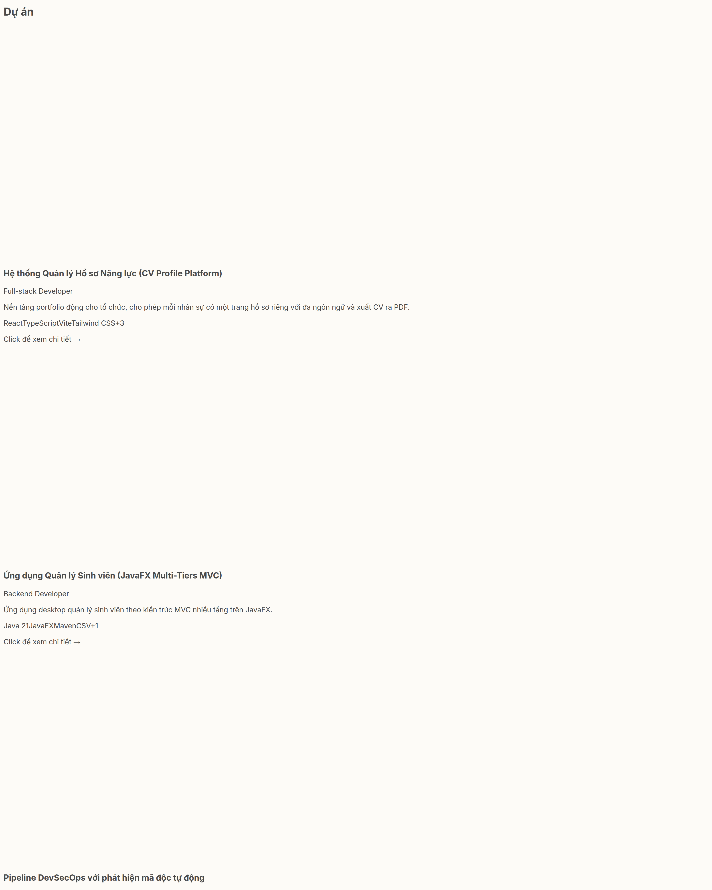
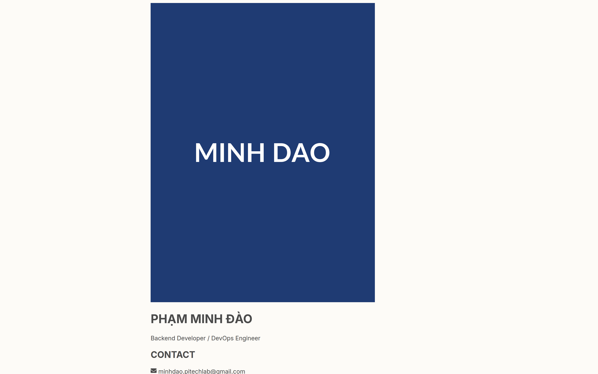
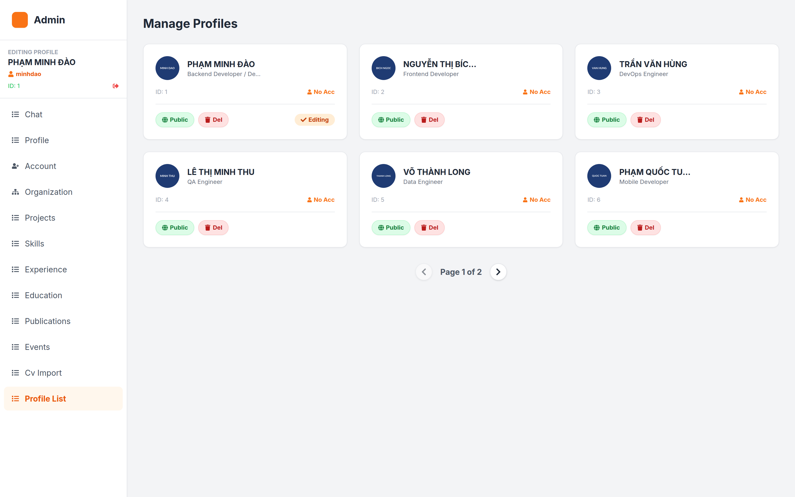
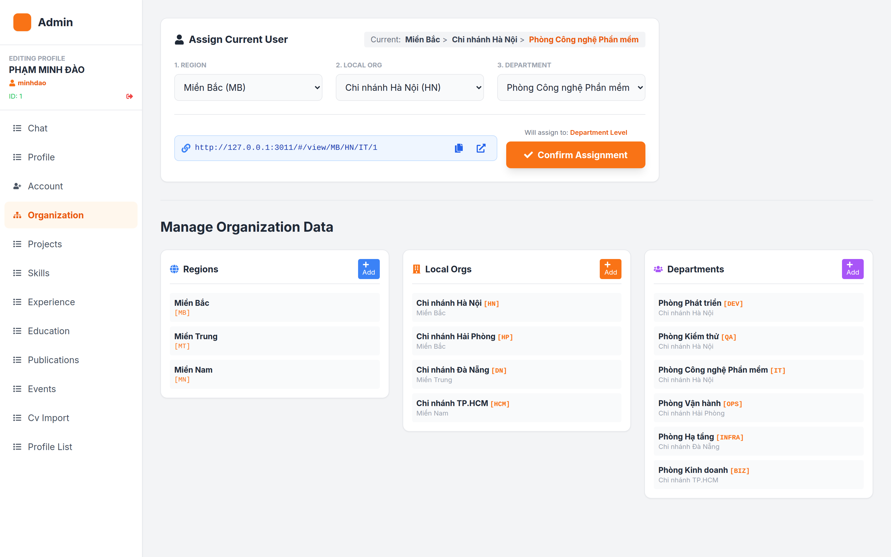
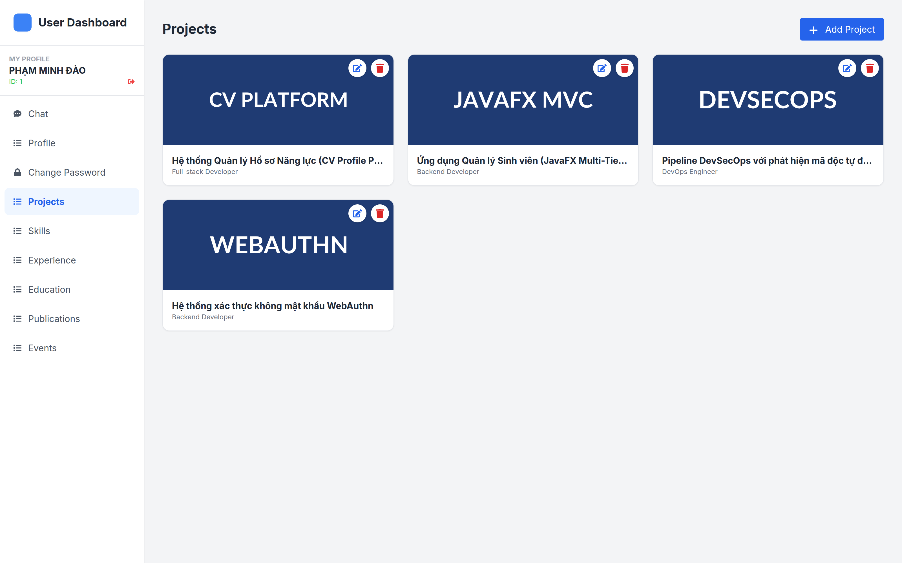

# 02 — ĐẶC TẢ CHỨC NĂNG

> **Hệ thống:** PITECH LAB — Dynamic Portfolio
> **Phạm vi:** Đặc tả hành vi quan sát được từ phía frontend (React 19 + Vite 6)
> **Quy ước:** Mỗi tác vụ ghi rõ **Kích hoạt → Xử lý → Kết quả → Lỗi**

---

## 1. Danh mục tác vụ người dùng

| # | Tác vụ | Vai trò | Màn hình | Mức độ ưu tiên |
|---|---|---|---|---|
| UC-01 | Xem trang portfolio công khai | Khách | `Home` | Cao |
| UC-02 | Xem hồ sơ theo đường dẫn tổ chức | Khách | `Home` | Cao |
| UC-03 | Chuyển đổi ngôn ngữ VI/EN | Tất cả | `Home` | Trung bình |
| UC-04 | Bật/tắt chế độ tối | Tất cả | `Home` | Thấp |
| UC-05 | Tải CV (in ra PDF) | Khách | `Home` | Cao |
| UC-06 | Xem chi tiết dự án | Khách | `Home` | Cao |
| UC-07 | Gửi tin nhắn cho quản trị | Khách | `ChatWidget` | Cao |
| UC-08 | Yêu cầu gọi video | Khách | `ChatWidget` | Cao |
| UC-09 | Đăng nhập | Admin/User | `Login` | Cao |
| UC-10 | Quản lý danh sách hồ sơ (duyệt/xóa/kích hoạt) | Admin | `Admin` | Cao |
| UC-11 | Chỉnh sửa thông tin chung của hồ sơ | Admin | `Admin` | Cao |
| UC-12 | Tạo tài khoản đăng nhập cho hồ sơ | Admin | `Admin` | Cao |
| UC-13 | Quản lý cây tổ chức 3 cấp | Admin | `Admin` | Cao |
| UC-14 | Gán hồ sơ vào đơn vị tổ chức | Admin | `Admin` | Cao |
| UC-15 | CRUD dự án / kỹ năng / kinh nghiệm / học vấn / công bố / thành tựu | Admin | `Admin` | Cao |
| UC-16 | Nhập CV bằng AI | Admin | `Admin` | Trung bình |
| UC-17 | Trả lời chat khách | Admin | `Admin` | Cao |
| UC-18 | Nhận & trả lời cuộc gọi video | Admin | `Admin` | Cao |
| UC-19 | Quản lý hồ sơ cá nhân | User | `User` | Cao |
| UC-20 | Đổi mật khẩu | User | `User` | Trung bình |
| UC-21 | Xem liên kết chia sẻ hồ sơ | User | `User` | Trung bình |

---

## 2. Phân tích vai trò (Persona)

### 2.1. Khách truy cập (Visitor)

- **Mục tiêu:** Tìm hiểu năng lực của một nhân sự PITECH LAB qua đường dẫn được chia sẻ.
- **Đặc điểm:** Không đăng nhập. Có thể là ứng viên, khách hàng, đối tác.
- **Nhu cầu:** Xem nhanh thông tin, xem dự án, tải CV, liên hệ trực tiếp.
- **Ràng buộc:** Không có token ⇒ không xem được hồ sơ chưa kích hoạt (quy định phía backend).

### 2.2. Quản trị viên (Admin)

- **Mục tiêu:** Quản lý toàn bộ dữ liệu hồ sơ và tổ chức; hỗ trợ khách truy cập.
- **Đặc điểm:** Được backend cấp `role = ADMIN`.
- **Nhu cầu:** Nhập liệu nhanh, duyệt hồ sơ, phân công đơn vị, trả lời chat/gọi video.
- **Công cụ chính:** 12 tab trong `pages/Admin.tsx`.

### 2.3. Nhân sự (User)

- **Mục tiêu:** Tự quản lý hồ sơ của mình.
- **Đặc điểm:** Được Admin tạo tài khoản gắn với `profileId`.
- **Nhu cầu:** Cập nhật dự án/kỹ năng, xem link chia sẻ, đổi mật khẩu.
- **Công cụ chính:** 9 tab trong `pages/User.tsx`.

---

## 3. Đặc tả màn hình công khai (`pages/Home.tsx`)


<!--SHOT-DONE:<!--SHOT:projects-->-->


**Section Dự án trên trang công khai**

> Lưới thẻ dự án hiển thị ảnh đại diện, tên, mô tả rút gọn và danh sách công nghệ. Nhấn vào thẻ sẽ mở modal chi tiết.


### 3.1. Cấu trúc trang

| # | Section | `id` | Điều kiện hiển thị | Nội dung |
|---|---|---|---|---|
| 1 | Hero | `hero` | Luôn | Avatar, logo nguyên tử, họ tên, chức danh, Expertise (4 kỹ năng đầu), Focus Areas (6 kinh nghiệm đầu), số điện thoại, email, nút tải CV, 3 thẻ thống kê |
| 2 | Lộ trình nghề nghiệp | `experience` | `workHistory.length > 0` | Timeline dọc, mở rộng dần (5 → +5) |
| 3 | Dự án | `projects` | `projects.length > 0` | `ZigZagSection` so le, mở rộng dần (3 → +3) |
| 4 | Học vấn | `education` | `education.length > 0` | Lưới 2 cột, thẻ bo tròn |
| 5 | Kỹ năng | `skills` | `skills.length > 0` | Lưới 3 cột, thanh tiến trình `proficiency%` |
| 6 | Nghiên cứu | `publications` | `publications.length > 0` | Nền tối, danh sách công bố + nút mở URL |
| 7 | Thành tựu | `events` | `events.length > 0` | Lưới 3 cột, icon `FaAward` |
| 8 | Footer | — | Luôn | Câu kết nối, icon GitHub/Linkedin/Email, bản quyền |

### 3.2. UC-01 — Xem trang portfolio công khai

**Kích hoạt:** Người dùng mở `/` hoặc `/view/...`.

**Xử lý:**
1. `Home` khởi tạo state: `loading=true`, `error=false`, `lang` từ `localStorage.app_lang`.
2. `useEffect` gọi `fetchData()` và mở kết nối STOMP.
3. `fetchData()` chọn nguồn dữ liệu theo số tham số URL (xem bảng ở [01 — mục 6](./01-TONG-QUAN-HET-THONG.md)).
4. Response được chuẩn hóa qua `mapBackendToFrontend()` rồi `setData()`.
5. `setLoading(false)`.

**Kết quả:**
- Thành công: render đầy đủ 8 section theo điều kiện dữ liệu.
- Đang tải: màn hình "System Booting..." với icon terminal nhấp nháy.
- Lỗi: dòng chữ **"Connection Error / Invalid Profile URL"** màu đỏ.

**Điều kiện biên:**
- `data = null` → coi như lỗi, hiển thị thông báo trên.
- Một section thiếu dữ liệu → **bị ẩn hoàn toàn**, không hiện thông báo "chưa có dữ liệu".

### 3.3. UC-02 — Xem hồ sơ theo đường dẫn tổ chức

**Định dạng URL:**

```
https://<host>/#/view/<rCode>/<lCode>/<dCode>/<profileId>   ← đầy đủ 3 cấp
https://<host>/#/view/<rCode>/<lCode>/<profileId>            ← 2 cấp
https://<host>/#/view/<rCode>/<profileId>                    ← 1 cấp
https://<host>/#/view/<profileId>                            ← không mã tổ chức
```

**Quy tắc chọn endpoint** (theo số mã tổ chức có trong URL):

| Số mã | Service được gọi | Endpoint |
|---|---|---|
| 3 | `getPortfolioByHierarchyCodes` | `GET /view/code/{r}/{l}/{d}/{pid}` |
| 2 | `getPortfolioByLocalOrg` | `GET /view/{r}/{l}/{pid}` |
| 1 | `getPortfolioByRegion` | `GET /view/{r}/{pid}` |
| 0 (có `id`) | `getPortfolioById` | `GET /admin/portfolio/{id}` |
| 0 (không `id`) | `getPortfolioData` | `GET /portfolio` |

**Kết quả:** Trang hiển thị hồ sơ tương ứng; phần "Hành trình nghề nghiệp" và các section khác dùng chung bộ dữ liệu của hồ sơ đó.

### 3.4. UC-03 — Chuyển đổi ngôn ngữ

| Bước | Hành vi |
|---|---|
| Kích hoạt | Bấm cờ VI/EN trong `Header` (desktop) hoặc nút VI/EN trong menu mobile |
| Xử lý | `changeLanguage(newLang)`: nếu ngôn ngữ hiện tại bằng → không làm gì; ghi `localStorage.app_lang = newLang`; **`window.location.reload()`** |
| Kết quả | Toàn trang tải lại, hiển thị theo ngôn ngữ mới |

**Lưu ý hành vi:**
- Đổi ngôn ngữ **ghi đè toàn bộ `localStorage`?** Không — chỉ ghi đè key `app_lang`, các key khác giữ nguyên.
- `Home` và `Header` đều lắng nghe sự kiện `storage` và `languageChanged` để đồng bộ mà không cần reload.
- `getTranslation()` fallback về tiếng Việt nếu key không tồn tại trong ngôn ngữ đang chọn.

**Nội dung đa ngôn ngữ còn thiếu:** nhãn "Xem thêm", chuỗi đếm kinh nghiệm, toàn bộ nhãn form nhập liệu, nhãn tab quản trị, số điện thoại hard-code — **vẫn hiển thị tiếng Việt ở cả hai chế độ**.

### 3.5. UC-04 — Chế độ sáng/tối

| Bước | Hành vi |
|---|---|
| Kích hoạt | Bấm công tắc `DarkModeSwitch` trong `Header` |
| Xử lý | `toggleDark()`: đảo state `isDark`; `document.documentElement.classList.toggle('dark')` |
| Kết quả | Toàn trang đổi theme; chuyển động màu 700ms; nền chuyển `bg-slate-50` ↔ `bg-black` |
| Giới hạn | **Không lưu trạng thái** — reload trang → về chế độ sáng |

### 3.6. UC-05 — Tải CV

**Kích hoạt:** Bấm nút "DOWNLOAD CV" trong Hero.

**Xử lý:**
1. `handlePrint()` từ `useReactToPrint({ contentRef: printRef, documentTitle: `${fullName}_Portfolio` })`.
2. Trình duyệt mở hộp thoại in; người dùng chọn "Save as PDF".
3. Nội dung in lấy từ `<PortfolioPrintTemplate>` (render trong `<div className="hidden">`).

**Cấu trúc bản in (A4 210×297mm):**

| Vùng | Nội dung |
|---|---|
| Header (nền `#1A1A1A`) | Avatar tròn 160px, họ tên (uppercase 5xl), chức danh (cam, viền 0.2em) |
| Sidebar trái (4/12, nền `#F8F9FA`) | **CONTACT** (email, điện thoại, địa chỉ) · **MY SKILLS** (tên + % + thanh tiến trình) · **EDUCATION** (bậc học, trường, năm) |
| Nội dung phải (8/12) | **ABOUT ME** (bio, in nghiêng) · **WORK EXPERIENCE** (vai trò, thời gian, công ty, mô tả) · **KEY PROJECTS** (tiêu đề, vai trò, mô tả) |
| Footer | Dòng bản quyền |

**Quy tắc bố cục:** `pageBreakInside: 'avoid'` trên từng khối — tránh cắt đôi một mục. `WebkitPrintColorAdjust: 'exact'` để giữ màu nền khi in.

**Lỗi:** nếu `avatarUrl` lỗi → thay bằng `https://via.placeholder.com/200?text=Profile`.

### 3.7. UC-06 — Xem chi tiết dự án


<!--SHOT-DONE:<!--SHOT:project-modal-->-->


**Modal chi tiết dự án**

> Modal hiển thị đầy đủ mô tả, vai trò đảm nhiệm, khách hàng, công nghệ sử dụng và liên kết tới mã nguồn / bản demo. Đóng bằng phím Esc hoặc nút ×.


| Bước | Hành vi |
|---|---|
| Kích hoạt | Bấm thẻ dự án trong `ZigZagSection` |
| Xử lý | `handleProjectClick(project)` → `setSelectedProject()` + `setIsModalOpen(true)`; render `ProjectModal` |
| Nội dung modal | Tiêu đề, mô tả (tự tách thành gạch đầu dòng theo `\n`, hoặc theo `.` nếu > 200 ký tự), vai trò, khách hàng, công nghệ (thẻ), link mã nguồn, link demo, ảnh gallery |
| Đóng | Bấm nút đóng, bấm ngoài vùng modal, hoặc nhấn **Esc** (đăng ký `keydown` khi modal mở) |
| Hiệu ứng | `document.body.style.overflow = 'hidden'` khi mở → `'unset'` khi đóng |

**Hiển thị dự án (luyên tiếp):** `ZigZagSection` hiển thị `visibleCount` dự án đầu (mặc định 3). Nút "Xem thêm ↓" tăng thêm 3 mỗi lần. Mô tả ngắn hiển thị lấy câu đầu tiên (≤120 ký tự), nếu câu đầu dài hơn thì cắt 120 ký tự + "...".

---

## 4. Đặc tả Chat (`components/ChatWidget.tsx`)

### 4.1. UC-07 — Gửi tin nhắn cho quản trị

**Kích hoạt:** Khách bấm nút tròn góc phải dưới để mở widget.

**Xử lý chi tiết:**

| Bước | Mô tả |
|---|---|
| 1 | `useEffect` khởi tạo định danh: đọc `localStorage.cv_visitor_id`; nếu chưa có → tạo `guest-` + 9 ký tự ngẫu nhiên base36 và lưu lại |
| 2 | `visitorName` = `Guest {4 ký tự cuối của visitorId}` |
| 3 | Khi widget mở → `connect()`: tạo SockJS tới `VITE_WS_URL`, `reconnectDelay: 5000` |
| 4 | Subscribe `/topic/private/{visitorId}` — nhận tin nhắn trả lời từ Admin |
| 5 | Người dùng gõ và nhấn Enter → `sendMessage()` |
| 6 | Đóng gói: `{ sender: visitorName, senderId: visitorId, content, type: 'CHAT', timestamp: localeTimeString }` |
| 7 | Publish `/app/chat.sendToAdmin` |
| 8 | **Hiển thị ngay lập tức** tin nhắn của mình vào danh sách (không chờ server) |
| 9 | Xóa nội dung ô nhập |

**Kết quả:**
- Tin của mình: nền cam, căn phải, góc dưới phải bo.
- Tin của Admin: nền trắng, căn trái, góc dưới trái bo.
- Danh sách tự cuộn xuống cuối (`scrollIntoView` mượt) khi có tin mới.
- Không có tin nào → "Xin chào! Bạn cần giúp gì?".

**Xử lý lỗi:**
- Chưa mở widget → gửi bị chặn (`!stompClientRef.current` → return).
- Nội dung rỗng hoặc chỉ khoảng trắng → bị chặn.
- Mất kết nối → STOMP tự thử lại sau 5 giây.

**Giới hạn đã biết:**
- Không lưu lịch sử chat — reload trang là mất.
- Không có phân trang hay tải thêm.
- Không có trạng thái "đã nhận" / "đã đọc".
- Không có rate limit phía client.

### 4.2. Trạng thái và hành vi giao diện

| Trạng thái | Hiển thị |
|---|---|
| Đóng | Nút tròn cam góc phải dưới, icon bình luận |
| Mở | Cửa sổ 320×450px, header cam "Hỗ trợ trực tuyến" + ID khách (8 ký tự đầu) + nút gọi video |
| Đang gọi video | Cửa sổ chat ẩn, `VideoCallInterface` chiếm toàn màn hình |

---

## 5. Đặc tả gọi video (`components/VideoCallInterface.tsx`)

### 5.1. UC-08 / UC-18 — Gọi video

**Kích hoạt:**
- *Khách:* bấm nút camera trên header widget chat.
- *Admin:* nhận thông báo cuộc gọi đến ở góc phải trên → bấm nút nhận (icon `FaVideo`).

**Xử lý:**

| Bước | Mô tả |
|---|---|
| 1 | Khách tạo `roomId = room-{visitorId}-{timestamp}` và publish `/app/video.request` với `{ roomId, visitorName }` |
| 2 | Backend đẩy tới `/topic/call-requests` (Admin) và `/topic/call-requests/{profileId}` (User) |
| 3 | Khi render, `startCall()` gọi `navigator.mediaDevices.getUserMedia({ video: true, audio: true })` |
| 4 | Tạo `RTCPeerConnection` với STUN `stun:stun.l.google.com:19302` |
| 5 | Thêm mọi track của stream vào peer connection |
| 6 | `connectSocket()` — SockJS tới `VITE_WS_URL`, subscribe `/topic/video/{roomId}` |
| 7 | **Admin** (bên gọi): sau 1 giây → `createOffer()` → publish `/app/video.signal` |
| 8 | **Khách** (bên nhận): nhận `offer` → `setRemoteDescription` → `createAnswer()` → publish `answer` |
| 9 | Trao đổi `ice-candidate` hai chiều; candidate đến sớm được xếp hàng và nạp lại sau khi có `remoteDescription` |
| 10 | `ontrack` gán `event.streams[0]` vào `<video>` từ xa |

**Định dạng tín hiệu STOMP (`/app/video.signal`):**

```json
{
  "type": "offer" | "answer" | "ice-candidate" | "end-call",
  "data": { ... },
  "from": "Admin" | "Visitor",
  "roomId": "room-xxx-1234567890"
}
```

**Bộ lọc phía nhận:** `if (signal.from !== userRole) handleSignal(signal)` — mỗi bên bỏ qua tín hiệu do chính mình phát.

**Kết thúc cuộc gọi:** bấm nút đỏ → publish tín hiệu `end-call` → cả hai bên gọi `onEndCall()` → đóng giao diện.

**Giao diện:**

| Thành phần | Mô tả |
|---|---|
| Màn hình chính | Video từ xa, `object-contain`, nền `#111827` |
| Overlay chờ | Vòng quay spinner + trạng thái ("Initializing...", "Accessing Camera...", "Connected", "Camera Error", "Failed") |
| Video local | Khung 144×208 (mobile) / 224×320 (desktop), **kéo di chuyển được** bằng `drag`, lật gương `scale-x-[-1]`, nhãn "Bạn" |
| Đồng hồ | Góc trái trên, đếm giây, định dạng `m:ss` |
| Nút phóng to/thu nhỏ | Góc phải trên, đổi giữa chế độ toàn màn hình và viền |
| Thanh điều khiển | Giữa dưới: mic (toggle), kết thúc (đỏ, 64×64), camera (toggle) |

**Xử lý lỗi:**

| Tình huống | Hành vi |
|---|---|
| Khách từ chối quyền camera/mic | `getUserMedia` ném lỗi → `setStatus('Camera Error')`, giao diện hiển thị lỗi |
| Không có thiết bị | Tương tự — `Camera Error` |
| Kết nối thất bại | `pc.onconnectionstatechange` → `setStatus('Failed')` |
| Thoát component | `cleanup()`: deactivate STOMP, **dừng mọi track media**, đóng peer connection |

**Giới hạn quan trọng:**
- **Không có TURN server** → hai bên cùng NAT ngăn chặn (mạng công ty, mạng di động) sẽ không kết nối được.
- Chỉ STUN công cộng của Google — phụ thuộc dịch vụ bên thứ ba.
- Không có giao thức chấp nhận/từ chối phía trước; Admin phải bấm nhận thủ công.
- `Admin` tạo `offer` sau delay cố định 1 giây — nếu Admin vào muộn hơn, tín hiệu có thể bị mất.
- Không có mã hóa bắt buộc ngoài DTLS-SRTP mặc định của WebRTC (đã có sẵn).

---

## 6. Đặc tả đăng nhập (`pages/Login.tsx`)

<!--SHOT:login-->

### 6.1. UC-09 — Đăng nhập

**Kích hoạt:** Truy cập `/login` (tự động khi truy cập `/admin` hoặc `/user` mà không có token).

**Xử lý:**

```
POST {API_BASE_URL}/api/v1/auth/login
Body: { username, password }
```

**Khi thành công:**

| Hành động | Điều kiện |
|---|---|
| `localStorage.token = token` | luôn |
| `localStorage.role = role` | luôn |
| `localStorage.profileId = profileId` | `profileId` có giá trị |
| `localStorage.username = username` | `username` có giá trị |
| `localStorage.fullName = fullName` | `fullName` có giá trị |
| Điều hướng `/admin` | `role === 'ADMIN'` |
| Điều hướng `/user` | ngược lại |

**Khi thất bại:**
- Hiển thị khối đỏ: `err.response?.data?.message` hoặc *"Đăng nhập thất bại. Vui lòng kiểm tra lại thông tin."*
- Giữ nguyên tên đăng nhập và mật khẩu trên form (không tự xóa).

**Giao diện:** thẻ trắng 448px tối đa, nền xám, tiêu đề "Đăng nhập hệ thống", 2 ô nhập có nhãn, nút xanh "Đăng nhập" full-width.

**Ghi chận:** `Login.tsx` dùng `axios` trực tiếp, **không** qua instance có interceptor — nên request login không có header `Accept-Language` và không có token.

---

## 7. Đặc tả bảng điều khiển Admin (`pages/Admin.tsx`)

### 7.1. Bố cục

```
┌──────────────┬──────────────────────────────────────────────┐
│  SIDEBAR     │  NỘI DUNG TAB                                  │
│  (80/256px)  │                                               │
│              │                                               │
│  Logo Admin  │                                               │
│  ──────────  │                                               │
│  Đang sửa:   │                                               │
│  <Tên>       │                                               │
│  @username   │                                               │
│  ID: n  [out]│                                               │
│  ──────────  │                                               │
│  • chat      │                                               │
│  • profile   │                                               │
│  • account   │                                               │
│  • organization                                              │
│  • projects  │                                               │
│  • skills    │                                               │
│  • experience│                                               │
│  • education │                                               │
│  • publications                                              │
│  • events    │                                               │
│  • cv-import │                                               │
│  • profile-list                                              │
└──────────────┴──────────────────────────────────────────────┘
```

Sidebar thu gọn còn 80px ở màn hình hẹp; nhãn tab chỉ hiện từ breakpoint `md`.

### 7.2. Các tab


<!--SHOT-DONE:<!--SHOT:admin-profile-list-->-->


**Tab Profile List — danh sách hồ sơ nhân sự**

> Quản trị viên công khai (Public) hoặc xóa (Del) hồ sơ; dữ liệu phân trang với tham số page/size, mặc định 6 bản ghi mỗi trang.


#### 7.2.1. Tab `chat` (mặc định)

**UC-17 — Trả lời chat khách.**

| Bước | Hành vi |
|---|---|
| 1 | `connectSocket()` — subscribe `/topic/admin/messages` và `/topic/call-requests` |
| 2 | Tin nhắn đến → `handleIncomingMessage()` → tạo/cập nhật `ChatSession` trong `chatSessions` |
| 3 | `unreadCount` tăng trừ khi đang xem đúng phiên đó **và** đang ở tab chat |
| 4 | Chọn phiên → hiển thị lịch sử, tin của Admin căn phải nền xanh, tin khách căn trái nền trắng |
| 5 | Gõ trả lời → publish `/app/chat.replyToUser` với `{ sender: 'Admin', senderId: 'admin', recipientId, content, type: 'CHAT', timestamp }` |
| 6 | Tin vừa gửi hiển thị ngay (optimistic) |

**Hiển thị danh sách phiên:** avatar tròn, tên khách, tin nhắn cuối cùng (truncate). Phiên đang chọn nền cam nhạt.

#### 7.2.2. Tab `profile` — UC-11

**Sửa thông tin chung của hồ sơ đang chọn.**

| Trường | Nguồn | Ghi chú |
|---|---|---|
| Ảnh đại diện | Upload file → `adminService.uploadImage()` | Overlay spinner khi đang tải; nút "Change" hiện khi hover |
| Họ tên | `fullName` | |
| Tiêu đề trang (VI) | `titleVi` | Gợi ý: dùng `\|` để ngắt dòng |
| Tiêu đề trang (EN) | `titleEn` | |
| Chức danh | `jobTitle` | |
| Email | `contact.email` | Cập nhật lồng vào `contact` |
| Điện thoại | `contact.phone` | Cập nhật lồng vào `contact` |
| Tiểu sử | `bio` | Textarea 4 dòng |

**Lưu:** `saveProfile()` → `adminService.updateProfile(editingProfile)` → `PUT /admin/profile` → thông báo thành công → `reloadProfileData()`.

**Hạn chế:** `strengths`, `workStyle`, `github`, `linkedin`, `location` **không có ô nhập** ở tab này — dù API có trả về.

#### 7.2.3. Tab `account` — UC-12

**Hai chế độ, tự chuyển theo trạng thái hồ sơ:**

| Chế độ | Điều kiện | Nội dung |
|---|---|---|
| **Tạo tài khoản** | `portfolioData.username` rỗng | Ô nhập username + mật khẩu + xác nhận; nút xanh "Register Account" |
| **Đổi mật khẩu** | `portfolioData.username` có giá trị | Username hiển thị read-only (ghi chú: *Username cannot be changed*), 2 ô mật khẩu; nút cam "Update Password" |

**Luồng tạo tài khoản:**

```
POST /api/v1/auth/register
Body: { profileId, fullName, username, password }
Header: Authorization: Bearer {token}
```

- Kiểm tra trước: mật khẩu ≠ xác nhận → cảnh báo, dừng. Username rỗng → cảnh báo, dừng. `portfolioData.id` rỗng → cảnh báo, dừng.
- Thành công → thông báo `✅ Đã tạo tài khoản cho profile: {tên}` → `reloadProfileData()` → chuyển sang chế độ "đổi mật khẩu".
- Thất bại → thông báo lỗi từ server.

**Hạn chế:** chế độ "đổi mật khẩu" **chưa được nối API** — hiện chỉ hiện thông báo *"Tính năng đổi mật khẩu user khác cần API Backend hỗ trợ!"*. Nút `(Dev: Switch Mode)` cho phép ép chuyển chế độ thủ công.

#### 7.2.4. Tab `organization` — UC-13, UC-14


<!--SHOT-DONE:<!--SHOT:admin-org-->-->


**Tab Organization — cây tổ chức ba cấp**

> Quản lý độc lập ba cấp: Vùng → Chi nhánh → Phòng ban. Khi gán hồ sơ vào phòng ban, ứng dụng sinh tự động đường dẫn chia sẻ theo mã vùng/mã chi nhánh/mã phòng ban.


Gồm 2 phần.

**(a) Gán hồ sơ vào tổ chức:**

```
┌─ Gán hồ sơ hiện tại ────────────────────────────────────┐
│  1. Vùng (Region)     2. Chi nhánh (Local Org)   3. Phòng ban (Dept)  │
│  [select, bắt buộc]   [select, cần Vùng]         [select, cần Chi nhánh] │
│                                                            │
│  Link chia sẻ: [http://host/#/view/MB/HN/IT/12] [copy] [mở] │
│  Sẽ gán tới: Department Level                              │
│  [✔ Xác nhận gán]                                           │
└────────────────────────────────────────────────────────────┘
```

**Quy tắc chọn lọc:**
- Danh sách Chi nhánh chỉ hiện những chi nhánh có `regionId === selRegionId`.
- Danh sách Phòng ban chỉ hiện những phòng ban có `localOrgId === selLocalId`.
- Đổi Vùng → xóa lựa chọn Chi nhánh và Phòng ban.
- Đổi Chi nhánh → xóa lựa chọn Phòng ban.
- Trường bị khóa (disabled) nếu cấp trên chưa chọn.

**Cấp gán:** ưu tiên đặc nhất đã chọn — Phòng ban > Chi nhánh > Vùng > "Chưa chọn cấp nào".

**Tạo link chia sẻ:** dựng theo cấp đã chọn:

| Đã chọn | Link sinh ra |
|---|---|
| Vùng + Chi nhánh + Phòng ban | `{origin}/#/view/{r.code}/{l.code}/{d.code}/{profileId}` |
| Vùng + Chi nhánh | `{origin}/#/view/{r.code}/{l.code}/{profileId}` |
| Chỉ Vùng | `{origin}/#/view/{r.code}/{profileId}` |
| Không chọn | `{origin}/#/view/{profileId}` |

**Gửi yêu cầu gán:** `PUT /admin/profile` với `{ id: profileId, departmentId? }` hoặc `{ id, localOrgId? }` hoặc `{ id, regionId? }` — chỉ gửi **một** trường, theo cấp cao nhất đã chọn.

**(b) Quản lý dữ liệu tổ chức:** ba cột, mỗi cột một cấp.

| Cấp | Trường | API |
|---|---|---|
| Vùng | `name`, `code` (tự uppercase) | `GET/POST /org/regions`, `PUT/DELETE /org/regions/{id}` |
| Chi nhánh | `name`, `code`, `regionId` | `/org/locals` |
| Phòng ban | `name`, `code`, `localOrgId` | `/org/departments` |

- Mỗi bản ghi hiện tên + mã dạng `[CODE]`; nút sửa/xóa ẩn cho tới khi hover.
- Xóa có hộp thoại xác nhận.
- Dữ liệu tổ chức được tải **lazy** — chỉ gọi `fetchOrgData()` khi mở tab.

**Khôi phục vị trí tổ chức:** khi mở tab, hệ thống dò ngược `departmentId` → `localOrgId` → `regionId` để đánh dấu đúng các select; nếu không có `departmentId` thì dò theo tên.

#### 7.2.5. Các tab CRUD nội dung — UC-15

Sáu tab: `projects`, `skills`, `experience`, `education`, `publications`, `events`.

**Mẫu chung:**

| Đặc tính | Mô tả |
|---|---|
| Nút thêm | "+ Add {loại}" góc phải, màu cam |
| Lưới | 2–3 cột, thẻ trắng viền, nút sửa (xanh) + xóa (đỏ) |
| Modal | Overlay tối 50%, thẻ trắng bo tròn, tiêu đề + nút đóng |
| Lưu | `POST` (thêm) hoặc `PUT` (sửa) → đóng modal → `reloadProfileData()` |
| Chốt nhấp đúp | Cờ `isSaving` → nút bị bỏ qua khi đang lưu |
| Xóa | `confirm()` → `DELETE` → `reloadProfileData()` |
| Lỗi | `alert('Error saving {loại}')` / `alert('Error')` |

**Chi tiết từng loại:**

| Loại | Trường nhập | Ghi chú |
|---|---|---|
| **Project** | title, role, customer, technologies (chuỗi, tách `,`), imageUrl (upload), repoUrl, description | Có thêm `demoUrl`, `gallery` trong model nhưng **không có ô nhập** |
| **Skill** | name, category (select: Backend/Frontend/Database/DevOps/Scientific), proficiency (số 0–100) | |
| **Experience** | company, role, startDate (date), endDate (date), description | Checkbox "Present" → `isCurrent=true` và khóa ô endDate |
| **Education** | schoolName, degree, startDate, endDate, description | Model client dùng `school`/`year`, form dùng `schoolName` — **xem UC-19 ghi chú** |
| **Publication** | title, publisher, releaseDate (date), url | |
| **Event** | name, role, date, description, imageUrl (upload) | |

**Upload ảnh:** `POST /upload` (multipart/form-data) → trả về URL → gán vào `avatarUrl` / `imageUrl` tương ứng.

#### 7.2.6. Tab `cv-import` — UC-16

**Kích hoạt:** Chọn file `.pdf` hoặc `.docx`.

**Xử lý:**
1. `confirm("Importing CV creates a NEW profile. Continue?")` — hủy thì dừng.
2. `setLoadingImport(true)` → hiển thị spinner + "AI Processing...".
3. `POST /admin/import-cv` (multipart).
4. Thành công → thông báo `✅ CV Imported successfully!` → về trang 0 → tải lại danh sách → chuyển sang tab `profile-list`.
5. Thất bại → `❌ Import failed!`.

**Ràng buộc:** `accept=".pdf,.docx"` chỉ ràng buộc phía trình duyệt; server phải tự kiểm tra lại.

#### 7.2.7. Tab `profile-list` — UC-10

**Danh sách hồ sơ, phân trang 6 bản ghi/trang.**

| Thành phần | Hành vi |
|---|---|
| Thẻ hồ sơ | Avatar 48px, họ tên (truncate 150px), chức danh, `ID: n`, username (cam, hoặc "No Acc") |
| Bấm thẻ | `handleSwitchProfile(id)` → tải hồ sơ → chuyển sang tab `profile` |
| Nút **Public** | `POST /admin/profile/{id}/activate` → hồ sơ công khai (có xác nhận) |
| Nút **Del** | `DELETE /admin/profile/{id}` (xác nhận, cảnh báo "không thể hoàn tác") → tải lại danh sách |
| Nhãn **Editing** | Hiện trên thẻ đang được sửa |
| Phân trang | Nút trước/sau, "Page {n} of {m}", nút bị vô hiệu ở biên |

**Tải danh sách:** `GET /admin/list?page={p}&size=6` → `{ content: [], totalPages }`. Trang đầu tiên tự tải hồ sơ đầu tiên vào form chỉnh sửa.

---

## 8. Đặc tả bảng điều khiển User (`pages/User.tsx`)

### 8.1. Khác biệt so với Admin

| Tiêu chí | Admin | User |
|---|---|---|
| Tab | 12 (gồm chat, organization, cv-import, profile-list) | 9 (chat, profile, change-password, + 6 CRUD) |
| Dữ liệu | Quản lý **mọi** hồ sơ | Chỉ hồ sơ của chính mình |
| API đọc | `/admin/*` | `/user/profile` |
| API ghi | `/admin/*` (kèm `profileId`) | `/user/*` (tự suy ra từ token) |
| Quản lý tổ chức | Có (CRUD 3 cấp + gán) | Không (chỉ đọc để sinh link) |
| Nhập CV | Có | Không |
| Đổi mật khẩu | Không (chưa nối API) | **Có, đã nối API** |
| Màu chủ đạo | Cam | Xanh dương |

### 8.2. UC-19 — Quản lý hồ sơ cá nhân


<!--SHOT-DONE:<!--SHOT:user-projects-->-->


**Tab Projects trong trang người dùng**

> Nhân sự tự thêm, sửa, xóa dự án của mình mà không cần quản trị viên can thiệp.


**Tải dữ liệu:** `GET /user/profile`. Response có thể là **mảng** → lấy phần tử đầu tiên; hoặc là object → dùng trực tiếp. Lưu `profileId` vào `localStorage`.

**Tab `profile`:**
- Sửa họ tên, tiêu đề VI/EN, chức danh, email, điện thoại, tiểu sử, ảnh đại diện.
- **Riêng biệt từ Admin:** có ô nhập "Website Title (VI)/(EN)" với placeholder giải thích cú pháp `|`.
- **Khu vực liên kết chia sẻ:** hiển thị link (read-only, nền xám nhạt) + nút sao chép + nút mở tab mới.

**Link chia sẻ (logic khác Admin):** dò từ `departmentId` lên `localOrgId` rồi `regionId`; nếu tìm đủ 3 cấp → link đầy đủ, ngược lại → `{origin}/#/view/{profileId}`.

**Các tab CRUD:** cùng bộ trường với Admin, nhưng gọi `userService.*` (không truyền `profileId` — backend tự xác định từ token).

### 8.3. UC-20 — Đổi mật khẩu

```
POST /api/v1/auth/change-password
Body: { currentPassword, newPassword, confirmPassword }
Header: Authorization: Bearer {token}
```

- Kiểm tra `newPassword !== confirmPassword` → cảnh báo "Mật khẩu xác nhận không khớp!" và dừng.
- Thành công → thông báo "Đổi mật khẩu thành công!" → xóa 3 ô nhập.
- Thất bại → thông báo lỗi từ server.

### 8.4. Chat của User

- Subscribe `/topic/private/{profileId}` (profileId lấy từ `localStorage`).
- Subscribe `/topic/call-requests/{profileId}`.
- Gửi: publish `/app/chat.replyToUser` với `senderId = portfolioData.id`.
- **Nút gọi video** trên header phiên chat → tạo `roomId = call-{profileId}-{visitorId}-{timestamp}` → mở `VideoCallInterface` với vai trò `User`.
- **Có ô tìm kiếm** trong danh sách phiên (không có chức năng — chỉ là UI).

> **Bất nhất phát hiện:** khi User nhận cuộc gọi qua `/topic/call-requests/{profileId}`, `roomId` do khách tạo có dạng `room-...`, nhưng khi User chủ động bấm gọi, `roomId` lại có dạng `call-...`. Hai quy ước khác nhau — cần backend xác nhận có xử lý được cả hai hay không.

---

## 9. Quy tắc nghiệp vụ tổng hợp

### 9.1. Quy tắc về dữ liệu

| # | Quy tắc |
|---|---|
| BR-01 | Hồ sơ chỉ hiển thị công khai khi backend đánh dấu active. |
| BR-02 | Mỗi hồ sơ gắn **tối đa một** vị trí tổ chức; cấp sâu nhất được ưu tiên. |
| BR-03 | Mã tổ chức (`code`) phải duy nhất trong phạm vi cấp của nó. |
| BR-04 | `proficiency` của kỹ năng là số nguyên 0–100, hiển thị dạng phần trăm. |
| BR-05 | `isCurrent = true` → hiển thị "Present" thay cho `endDate`. |
| BR-06 | Tiêu đề trang dùng `|` làm dấu phân cách dòng; không có `|` → hiển thị 1 dòng. |
| BR-07 | `technologies` lưu dạng chuỗi phân tách bởi dấu phẩy; client tách và `trim`. |
| BR-08 | `teamMembers` nhận cả mảng hoặc chuỗi phân tách dấu phẩy. |
| BR-09 | Mỗi hồ sơ có **nhiều nhất một tài khoản** đăng nhập (username). |

### 9.2. Quy tắc về phân quyền

| # | Quy tắc |
|---|---|
| BR-10 | `role = ADMIN` → toàn quyền trên `/api/v1/admin/**`. |
| BR-11 | Tài khoản `USER` → chỉ được sửa hồ sơ của chính mình. |
| BR-12 | Thêm/Xóa hồ sơ → chỉ Admin. |
| BR-13 | Quản lý cây tổ chức → chỉ Admin. |
| BR-14 | Gán hồ sơ vào tổ chức → chỉ Admin. |
| BR-15 | Import CV → chỉ Admin. |
| BR-16 | Xem hồ sơ công khai → không cần token. |

> **Quy tắc BR-10 đến BR-16 phải được thực thi ở backend.** Frontend chỉ ẩn/hiện nút — không phải rào chắn bảo mật.

### 9.3. Quy tắc realtime

| # | Quy tắc |
|---|---|
| BR-17 | Mọi tin nhắn chat mang `senderId` để định tuyến về đúng người nhận. |
| BR-18 | Tin nhắn gửi tới Admin đi qua `/app/chat.sendToAdmin`; tin trả lời qua `/app/chat.replyToUser`. |
| BR-19 | Topic theo người dùng: `/topic/private/{id}`; Admin dùng topic tổng `/topic/admin/messages`. |
| BR-20 | Khi hồ sơ được cập nhật, backend phát `/topic/public/updates` với nội dung `PROFILE_UPDATED` → trang công khai tự tải lại. |
| BR-21 | Tín hiệu video gắn `roomId`; mỗi bên bỏ qua tín hiệu do chính mình phát (`from === userRole`). |

---

## 10. Ma trận truy vết tác vụ ↔ mã nguồn

| Tác vụ | Hàm xử lý | Tệp |
|---|---|---|
| UC-01 | `Home.fetchData()` | `pages/Home.tsx` |
| UC-02 | `Home.fetchData()` (nhánh theo `params.length`) | `pages/Home.tsx` |
| UC-03 | `Header.changeLanguage()` | `components/Header.tsx` |
| UC-04 | `Home.toggleDark()` | `pages/Home.tsx` |
| UC-05 | `Home.handlePrint()` | `pages/Home.tsx` |
| UC-06 | `ZigZagSection.handleProjectClick()` | `components/ZigZagSection.tsx` |
| UC-07 | `ChatWidget.sendMessage()` | `components/ChatWidget.tsx` |
| UC-08 | `ChatWidget.startVideoCall()` | `components/ChatWidget.tsx` |
| UC-09 | `Login.handleLogin()` | `pages/Login.tsx` |
| UC-10 | `Admin.handleDeleteProfile/handleActivateProfile/handleSwitchProfile` | `pages/Admin.tsx` |
| UC-11 | `Admin.saveProfile()` | `pages/Admin.tsx` |
| UC-12 | `Admin.handleAccountAction()` | `pages/Admin.tsx` |
| UC-13 | `Admin.saveRegion/saveLocal/saveDept` | `pages/Admin.tsx` |
| UC-14 | `Admin.handleAssignOrg()` | `pages/Admin.tsx` |
| UC-15 | `Admin.save{Project,Skill,Experience,Education,Publication,Event}` | `pages/Admin.tsx` |
| UC-16 | `Admin.handleImportCV()` | `pages/Admin.tsx` |
| UC-17 | `Admin.sendReply()` | `pages/Admin.tsx` |
| UC-18 | `Admin` (nhận cuộc gọi) + `VideoCallInterface.startCall()` | `pages/Admin.tsx`, `components/VideoCallInterface.tsx` |
| UC-19 | `User.saveProfile()`, `User.save{...}` | `pages/User.tsx` |
| UC-20 | `User.handleChangePassword()` | `pages/User.tsx` |
| UC-21 | `User.generateShareLink()` | `pages/User.tsx` |

---

## 11. Bảng theo dõi yêu cầu thay đổi

| ID | Yêu cầu | Trạng thái | Ghi chú |
|---|---|---|---|
| CR-01 | Đổi mật khẩu từ tab `account` của Admin | ❌ Chưa làm | Cần API backend |
| CR-02 | Nhập liên kết GitHub/Linkedin tại UI | ❌ Chưa có ô nhập | API có trả về |
| CR-03 | Nhập `demoUrl`, `gallery` cho dự án | ❌ Chưa có ô nhập | Model có sẵn |
| CR-04 | Lưu lịch sử chat | ❌ Chưa làm | `getChatHistory()` đã khai báo, chưa gọi |
| CR-05 | Tải CV từ endpoint `/export/cv-data` | ❌ Chưa dùng | `downloadCV()` đã khai báo, chưa gọi |
| CR-06 | Xóa bộ lọc / sắp xếp danh sách hồ sơ | ❌ Chưa có | Chỉ có phân trang |
| CR-07 | Nhớ trạng thái chế độ tối | ❌ Chưa làm | |
| CR-08 | Đa ngôn ngữ cho toàn bộ nhãn | ❌ Chỉ một phần | |
| CR-09 | Tìm kiếm phiên chat (User) | ❌ Chỉ có UI | Ô tìm kiếm không có handler |
| CR-10 | Kiểm thử tự động | ❌ Chưa có | 0 test trong repo |

Tiếp theo: [03 — Hướng dẫn cài đặt & sử dụng](./03-HUONG-DAN-CAI-DAT-VA-SU-DUNG.md)
