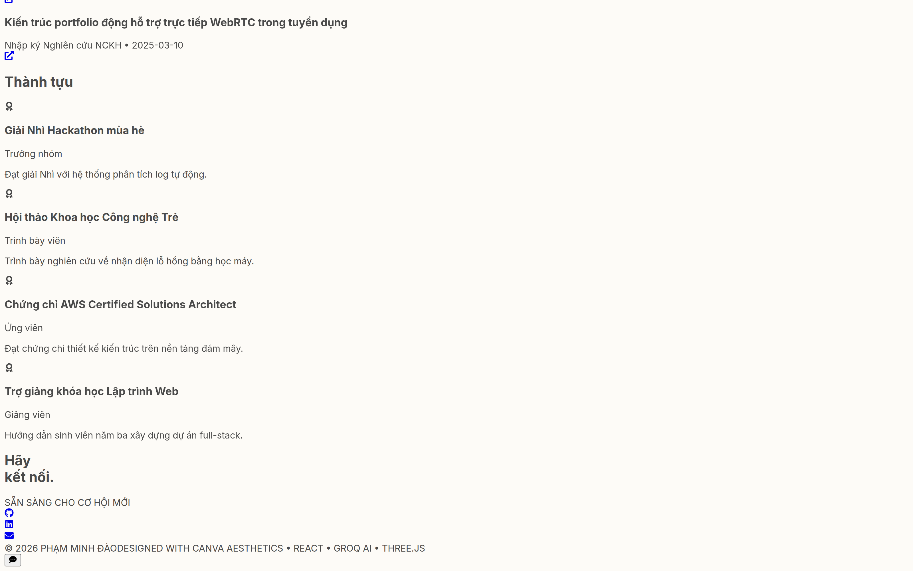
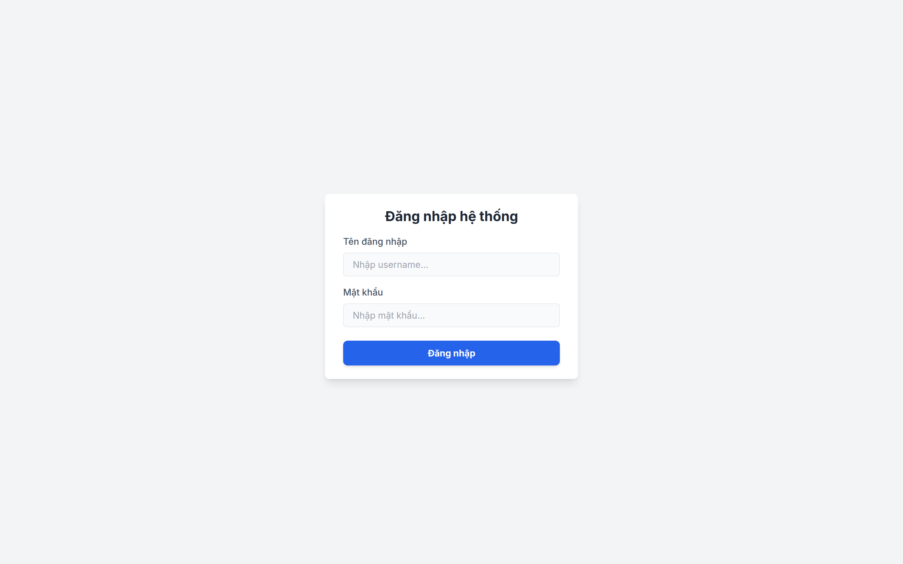
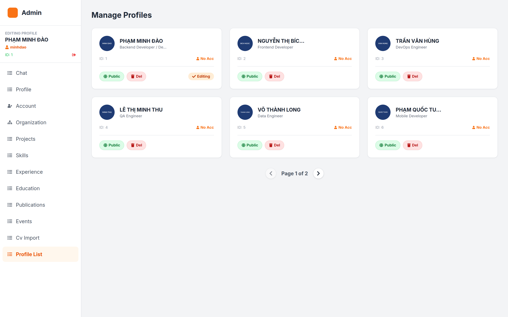
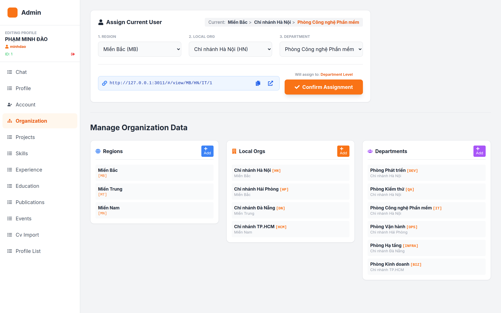
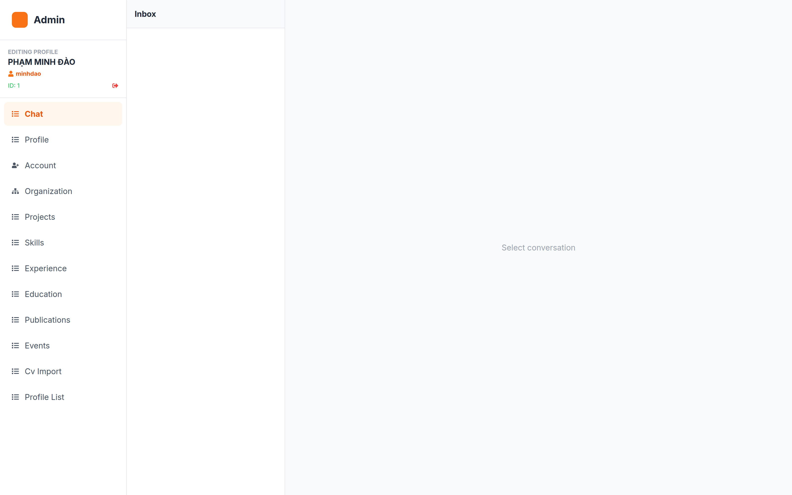
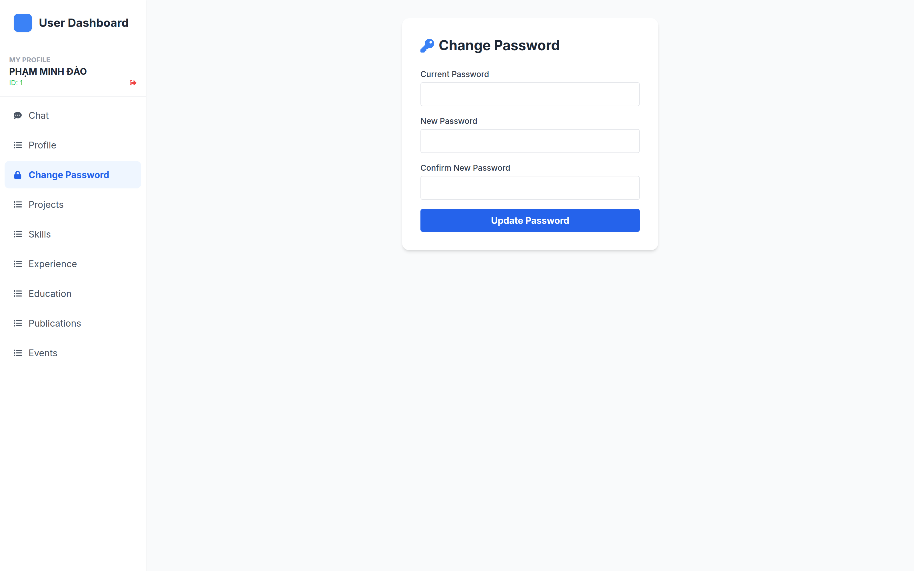

# 03 — HƯỚNG DẪN CÀI ĐẶT & SỬ DỤNG

> **Hệ thống:** PITECH LAB — Dynamic Portfolio
> **Dành cho:** Người cài đặt, người vận hành, lập trình viên mới tiếp nhận

---

## 1. Yêu cầu hệ thống

### 1.1. Phần mềm bắt buộc

| Phần mềm | Phiên bản tối thiểu | Phiên bản khuyến nghị | Ghi chú |
|---|---|---|---|
| **Node.js** | ≥ 18.0.0 | 20.x hoặc 22.x | `three` và `@react-three/*` cần Node ≥ 18 |
| **npm** | ≥ 9.0 | 10.x | Hoặc dùng `pnpm` / `yarn` |
| **Trình duyệt** | Chrome/Edge/Firefox bản mới nhất | Chrome ≥ 110 | Cần hỗ trợ WebRTC, ES2022 |
| **Backend API** | — | — | Xem [mục 3](#3-cấu-hình-backend) |

### 1.2. Kiểm tra môi trường

```bash
node -v    # v18.0.0 trở lên
npm -v     # v9.0.0 trở lên
```

### 1.3. Yêu cầu phía trình duyệt

| Tính năng | Yêu cầu |
|---|---|
| Gọi video | Cần HTTPS **hoặc** `localhost` (trình duyệt chặn `getUserMedia` trên HTTP thường) |
| Chat realtime | WebSocket/SockJS tới backend — cần firewall cho phép |
| Nền 3D | WebGL — hầu hết GPU tích hợp đều đạt |
| In CV | Trình duyệt hỗ trợ hộp thoại in (không dùng được ở chế độ ẩn danh trên mobile) |

---

## 2. Cài đặt

### 2.1. Lấy mã nguồn

```bash
git clone https://github.com/dao24092004/pitechlab-cv-profile.git
cd pitechlab-cv-profile
```

### 2.2. Cài dependencies

```bash
npm install
```

**Kết quả mong đợi:** thêm ~180 package, không có lỗi `ERESOLVE`.

> **Cảnh báo `EBADENGINE`.** Package `camera-controls@3.1.2` (kéo về bởi `@react-three/drei`) yêu cầu `node >= 22.0.0` và `npm >= 10.5.1`. Với Node 20 hoặc npm 9, npm sẽ in cảnh báo — **đây chỉ là cảnh báo, không chặn cài đặt**. Xem [mục 8.1](#81-cảnh-báo-ebadengine) để xử lý.

### 2.3. Kiểm tra cài đặt

```bash
npm run build     # phải kết thúc với "✓ built in Xs"
```

---

## 3. Cấu hình backend

### 3.1. Biến môi trường

Tạo file `.env.local` ở thư mục gốc:

```bash
# .env.local
VITE_API_URL=https://api.pitechlab.vn
VITE_WS_URL=https://api.pitechlab.vn/ws
```

### 3.2. Bảng biến môi trường

| Biến | Bắt buộc | Mặc định khi thiếu | Dùng ở |
|---|---|---|---|
| `VITE_API_URL` | ✅ | `http://localhost:8080` | Gốc REST API. `services/api.ts`, `pages/Home.tsx`, `pages/Login.tsx`, `pages/User.tsx`, `pages/Admin.tsx` |
| `VITE_WS_URL` | ✅ | *(không có mặc định → lỗi)* | Địa chỉ SockJS. `components/ChatWidget.tsx`, `components/VideoCallInterface.tsx`, `pages/User.tsx`, `pages/Admin.tsx` |

> **Lưu ý:** `Home.tsx` dùng `${API_BASE_URL}/ws` cho SockJS, còn các trang khác dùng `VITE_WS_URL`. Trong môi trường thật, **hai giá trị này phải trỏ về cùng một endpoint SockJS**. Nếu `VITE_WS_URL` = `https://api/ws` thì `Home` sẽ dùng `https://api/ws` — khớp. Hãy đặt `VITE_WS_URL` trùng với `<API_BASE_URL>/ws`.

### 3.3. Quy ước URL đầy đủ

| Mục đích | URL |
|---|---|
| REST API | `{VITE_API_URL}/api/v1/...` |
| SockJS (khuyến nghị) | `{VITE_API_URL}/ws` |
| Ảnh tải lên | `{VITE_API_URL}{đường dẫn tương đối do backend trả về}` |

### 3.4. Danh mục endpoint backend phải cung cấp

> Đây là **danh mục phụ thuộc** để backend đối chiếu — không phải đặc tả thiết kế backend.

**Nhóm đọc dữ liệu portfolio (công khai):**

| Method | Đường dẫn | Dùng bởi |
|---|---|---|
| GET | `/api/v1/portfolio` | `Home` (hồ sơ mặc định) |
| GET | `/api/v1/admin/portfolio/{id}` | `Home` (`/view/{id}`), `Admin` |
| GET | `/api/v1/view/{rCode}/{pid}` | `Home` (2 tham số) |
| GET | `/api/v1/view/code/{r}/{l}/{d}/{pid}` | `Home` (3 tham số) |

**Nhóm quản trị:**

| Method | Đường dẫn |
|---|---|
| GET | `/api/v1/admin/list?page={p}&size=6` |
| PUT | `/api/v1/admin/profile` |
| DELETE | `/api/v1/admin/profile/{id}` |
| POST | `/api/v1/admin/profile/{id}/activate` |
| POST/PUT/DELETE | `/api/v1/admin/projects[/{id}]` |
| POST/PUT/DELETE | `/api/v1/admin/skills[/{id}]` |
| POST/PUT/DELETE | `/api/v1/admin/experiences[/{id}]` |
| POST/PUT/DELETE | `/api/v1/admin/educations[/{id}]` |
| POST/PUT/DELETE | `/api/v1/admin/publications[/{id}]` |
| POST/PUT/DELETE | `/api/v1/admin/events[/{id}]` |
| GET | `/api/v1/admin/projects/{id}` *(đã khai báo, chưa gọi)* |

**Nhóm tổ chức:**

| Method | Đường dẫn |
|---|---|
| GET/POST/PUT/DELETE | `/api/v1/org/regions[/{id}]` |
| GET/POST/PUT/DELETE | `/api/v1/org/locals[/{id}]` |
| GET/POST/PUT/DELETE | `/api/v1/org/departments[/{id}]` |

**Nhóm người dùng:**

| Method | Đường dẫn |
|---|---|
| GET | `/api/v1/user/profile` |
| PUT | `/api/v1/user/profile` |
| GET/PUT/DELETE | `/api/v1/user/{projects,skills,experiences,educations,publications,events}[/{id}]` |
| POST | `/api/v1/user/import-cv` *(đã khai báo, chưa gọi)* |

**Nhóm xác thực & tệp:**

| Method | Đường dẫn |
|---|---|
| POST | `/api/v1/auth/login` |
| POST | `/api/v1/auth/register` |
| POST | `/api/v1/auth/change-password` |
| POST | `/api/v1/upload` *(multipart)* |
| POST | `/api/v1/admin/import-cv` *(multipart)* |
| GET | `/api/v1/export/cv-data` *(đã khai báo, chưa gọi)* |
| GET | `/api/v1/chat/history` *(đã khai báo, chưa gọi)* |

---

## 4. Chạy ứng dụng

### 4.1. Chế độ phát triển

```bash
npm run dev
```

| Mục | Giá trị |
|---|---|
| Địa chỉ | `http://localhost:3000` |
| Host | `0.0.0.0` (truy cập được từ máy khác trong mạng nội bộ) |
| Port khác | `npm run dev -- --port 4000` |
| Tự reload | Có (HMR) |

### 4.2. Build production

```bash
npm run build      # sinh thư mục dist/
npm run preview    # xem trước bản build, mặc định port 4173
```

### 4.3. Cấu trúc thư mục `dist/`

```
dist/
├── index.html
└── assets/
    ├── index-<hash>.js      (~1,6 MB → ~460 KB gzip)
    └── index-<hash>.css     (~0,24 KB)
```

### 4.4. Các script có sẵn

| Script | Lệnh | Tác dụng |
|---|---|---|
| `dev` | `vite` | Dev server + HMR |
| `build` | `vite build` | Build production vào `dist/` |
| `preview` | `vite preview` | Phục vụ bản build cục bộ |

> **Không có script `test`, `lint`, `format`.** Xem [mục 8.5](#85-thiếu-công-cụ-chất-lượng-mã).

---

## 5. Triển khai

### 5.1. Yêu cầu máy chủ

| Mục | Yêu cầu |
|---|---|
| Loại | Static hosting (Nginx, Caddy, Netlify, Vercel, Cloudflare Pages, GitHub Pages) |
| Node.js trên máy chủ | Không cần ở runtime — chỉ cần lúc build |
| Backend | Phải chạy riêng, frontend gọi qua HTTPS |
| CORS | Backend phải cho phép origin của frontend |

### 5.2. Quy trình triển khai

```bash
# 1. Cài dependency (máy build hoặc CI)
npm ci

# 2. Tạo file biến môi trường cho production
cat > .env.production << 'EOF'
VITE_API_URL=https://api.pitechlab.vn
VITE_WS_URL=https://api.pitechlab.vn/ws
EOF

# 3. Build
npm run build

# 4. Đưa nội dung dist/ lên máy chủ
```

> `.env.production` **không** nằm trong `.gitignore` (chỉ `.env.local` và `.env.*.local` bị chặn). Hãy chắc chắn file này không được commit — hoặc dùng `.env.production.local` để an toàn hơn.

### 5.3. Cấu hình Nginx mẫu

```nginx
server {
    listen 443 ssl;
    server_name cv.pitechlab.vn;

    root /var/www/pitechlab-cv/dist;
    index index.html;

    # Bắt buộc: SPA dùng HashRouter, file build có tên hash
    location /assets/ {
        expires 1y;
        add_header Cache-Control "public, immutable";
    }

    location / {
        try_files $uri $uri/ /index.html;
    }
}
```

> Vì dùng `HashRouter`, các đường dẫn có dạng `/#/view/MB/HN/IT/12` — phần sau `#` **không** được gửi lên máy chủ. Vì vậy `try_files` không bắt buộc, nhưng vẫn nên giữ để an toàn.

### 5.4. Biến môi trường trong CI/CD

Vite **chỉ đọc biến môi trường lúc build**, không phải lúc runtime. Mỗi môi trường cần một lần build riêng:

```yaml
# Ví dụ GitHub Actions
- name: Build
  run: npm run build
  env:
    VITE_API_URL: ${{ secrets.API_URL }}
    VITE_WS_URL: ${{ secrets.WS_URL }}
```

### 5.5. Kiểm tra sau khi triển khai

```
✓ Trang chủ tải được, hiển thị "System Booting..." rồi nội dung
✓ Đăng nhập được bằng tài khoản thật
✓ Vào /admin hiển thị danh sách hồ sơ
✓ Mở widget chat, gửi tin — không báo lỗi trong console
✓ Bấm "DOWNLOAD CV" — hiện hộp thoại in
✓ Trang không báo lỗi CORS trong tab Console
```

---

## 6. Hướng dẫn sử dụng theo vai trò

### 6.1. Khách truy cập


<!--SHOT-DONE:<!--SHOT:home-footer-->-->


**Chân trang trang chủ — nơi đặt thông tin liên hệ**

> Chân trang chứa thông tin liên hệ (email, GitHub, LinkedIn) và nút tải CV.


| Bước | Thao tác |
|---|---|
| 1 | Mở đường dẫn được chia sẻ, ví dụ `https://cv.pitechlab.vn/#/view/MB/HN/IT/12` |
| 2 | Xem hồ sơ: cuộn qua các section |
| 3 | Bấm **DỰ ÁN** để xem chi tiết từng dự án (bấm **Esc** để đóng) |
| 4 | Bấm **DOWNLOAD CV** → chọn "Save as PDF" trong hộp thoại in |
| 5 | Bấm nút tròn góc phải dưới để **chat** với quản trị |
| 6 | Bấm nút camera trên header chat để **gọi video** (cho phép quyền camera/mic khi trình duyệt hỏi) |

**Mẹo:**
- Đổi ngôn ngữ: bấm cờ VI/EN góc phải trên.
- Bật chế độ tối: bấm công tắc mặt trăng/mặt trời.
- Nút "Xem thêm" ở section Dự án và Lộ trình nghề nghiệp để xem phần còn lại.

### 6.2. Quản trị viên (Admin)


<!--SHOT-DONE:<!--SHOT:login-->-->


**Trang đăng nhập — bước đăng nhập đầu tiên**

> Mở `/login`, nhập tài khoản được cấp ở tab `account` của quản trị viên. Hệ thống tự chuyển hướng theo vai trò.


**Đăng nhập:** `/login` → nhập tài khoản → tự động vào `/admin`.


<!--SHOT-DONE:<!--SHOT:admin-profile-list-->-->


**Bảng điều khiển quản trị — bước kiểm tra danh sách hồ sơ**

> Sau khi đăng nhập bằng tài khoản ADMIN, bạn sẽ thấy bảng điều khiển này. Danh sách hồ sơ nằm ở tab `profile-list`.


**Các tab và thứ tự thao tác thường dùng:**

| Bước | Tab | Thao tác |
|---|---|---|
| 1 | `profile-list` | Xem toàn bộ hồ sơ. Bấm **Public** để công khai, **Del** để xóa |
| 2 | `profile` | Nhập thông tin chung: họ tên, ảnh, chức danh, tiêu đề VI/EN, email, điện thoại, tiểu sử |
| 3 | `account` | Tạo tài khoản đăng nhập cho hồ sơ (chỉ khi username còn trống) |
| 4 | `organization` | Gán hồ sơ vào Vùng/Chi nhánh/Phòng ban → copy link chia sẻ |
| 5 | `projects` → `skills` → `experience` → `education` → `publications` → `events` | Nhập dữ liệu chi tiết |
| 6 | `cv-import` | Nhập file CV để tạo hồ sơ tự động |
| 7 | `chat` | Trả lời tin nhắn của khách, nhận cuộc gọi video |

**Mẹo:**
- Bấm vào một thẻ trong `profile-list` để chuyển sang sửa hồ sơ đó.
- Mã tổ chức nhập tự động chuyển chữ hoa — dùng mã ngắn, ví dụ `MB`, `HN`, `IT`.
- Khi gán tổ chức, link chia sẻ cập nhật tự động — bấm nút copy để lấy.
- Nút **Save Changes** chỉ lưu thông tin chung; các section khác có nút lưu riêng trong modal.


<!--SHOT-DONE:<!--SHOT:admin-org-->-->


**Gán tổ chức và lấy link chia sẻ**

> Tại tab `organization`, chọn Phòng ban cho hồ sơ rồi bấm nút copy để lấy đường dẫn chia sẻ dạng `/#/view/{mã vùng}/{mã chi nhánh}/{mã phòng ban}/{profileId}`.


<!--SHOT-DONE:<!--SHOT:admin-chat-->-->


**Trả lời tin nhắn của khách truy cập**

> Khách gửi tin từ widget chat góc phải trang chủ. Tin hiển thị ở đây kèm bộ đếm tin chưa đọc; nút camera cho phép gọi video WebRTC trực tiếp.


### 6.3. Nhân sự (User)

**Đăng nhập:** `/login` → tự động vào `/user`.


<!--SHOT-DONE:<!--SHOT:user-password-->-->


**Đổi mật khẩu ở trang người dùng**

> Tab `change-password` yêu cầu nhập mật khẩu hiện tại trước khi đặt mật khẩu mới.


| Bước | Thao tác |
|---|---|
| 1 | Tab `profile` — cập nhật thông tin cá nhân, tải ảnh đại diện |
| 2 | Copy **My Portfolio Link** để chia sẻ hồ sơ |
| 3 | Các tab `projects`, `skills`, `experience`, `education`, `publications`, `events` — thêm/sửa/xóa dữ liệu của bạn |
| 4 | Tab `change-password` — đổi mật khẩu (cần mật khẩu hiện tại) |
| 5 | Tab `chat` — trả lời khách đang liên hệ với bạn |

**Mẹo:**
- Ô **Website Title (VI)/(EN)** nhận theo mẫu `Dòng 1 | Dòng 2` để tách 2 dòng tiêu đề.
- Ở mục Kinh nghiệm, tick **Present** nếu bạn còn làm việc — ngày kết thúc sẽ bị khóa và hiển thị "Present".
- Mức độ kỹ năng nhập từ 0 đến 100.

---

## 7. Xử lý sự cố

### 7.1. Lỗi cài đặt & build

| Triệu chứng | Nguyên nhân | Xử lý |
|---|---|---|
| `npm ERR! ERESOLVE unable to resolve dependency tree` | Xung đột phiên bản peer dependency | `npm install --legacy-peer-deps` |
| `EBADENGINE Unsupported engine` | `camera-controls` cần Node ≥ 22 | Nâng Node lên 22.x, hoặc npm 10.5.1+; cảnh báo không chặn build |
| `Cannot find module '@/components/...'` | Thiếu alias | Kiểm tra `vite.config.ts` và `tsconfig.json` cùng có `paths: {"@/*": ["./*"]}` |
| `Port 3000 is already in use` | Cổng bị chiếm | `npm run dev -- --port 3001` hoặc `kill -9 $(lsof -ti:3000)` |
| Build thành công nhưng trang trắng | Tailwind không được xử lý — xem [7.2](#72-trang-trắng-hoặc-mất-định-dạng) | Kiểm tra mạng tới `cdn.tailwindcss.com` |

### 7.2. Trang trắng hoặc mất định dạng

**Nguyên nhân gốc:** Tailwind **không được build** — repo không có `tailwindcss` trong `package.json`, không có `postcss.config.js`, không có plugin PostCSS. File `index.css` giữ nguyên các directive `@tailwind base;` (không được xử lý), và `index.html` nạp Tailwind qua **CDN**.

Hệ quả:
- Toàn bộ style phụ thuộc mạng — mất mạng là mất giao diện.
- CDN Tailwind quét DOM tại runtime → hiệu ứng nhấp nháy (flash of unstyled content) lúc tải.
- Bảng `tailwind.config` trong `index.html` chỉ khai báo màu `canva-*` → **ghi đè** theme trong `tailwind.config.js`; các utility không có trong CDN config có thể không được sinh.
- Có nguy cơ **XSS** vì CDN cho phép thực thi JS từ domain bên thứ ba.

**Cách kiểm tra:** mở DevTools → tab Console → tìm lỗi tải `cdn.tailwindcss.com`. Kiểm tra file CSS trong `dist/assets/` — nếu nó chỉ chứa `@tailwind base;@tailwind components;...` thì Tailwind chưa được xử lý.

**Cách khắc phục (khuyến nghị — cần duyệt thay đổi mã nguồn):**

```bash
npm install -D tailwindcss@3 postcss autoprefixer
npx tailwindcss init -p
```

Sau đó: xóa `<script src="https://cdn.tailwindcss.com">` và khối `<script> tailwind.config = {...} </script>` khỏi `index.html`, giữ lại `import './index.css'` trong `index.tsx`. Và **cần kiểm tra lại toàn bộ giao diện** vì theme đang chạy khác với theme khai báo trong `tailwind.config.js`.

> Vì đây là thay đổi kiến trúc hiển thị, tài liệu này **không tự ý áp dụng**. Xem khuyến nghị tại [04 — Kiểm tra & bàn giao](./04-KIEM-TRA-VA-BAN-GIAO.md).

### 7.3. Lỗi kết nối API

| Triệu chứng | Nguyên nhân | Xử lý |
|---|---|---|
| "Connection Error / Invalid Profile URL" | Backend không trả lỗi hoặc sai URL | Kiểm tra `VITE_API_URL`; mở Network tab xem request nào fail |
| `CORS policy: No 'Access-Control-Allow-Origin'` | Backend chưa cấu hình CORS | Thêm origin của frontend vào danh sách allow |
| `401 Unauthorized` sau khi token hết hạn | Không có cơ chế refresh token | Backend cần trả `WWW-Authenticate`; frontend nên xử lý 401 → đăng nhập lại (**chưa có** — xem tài liệu 04) |
| `403 Forbidden` khi vào `/admin` | Token không có role ADMIN | Kiểm tra `localStorage.role`; backend phải phân quyền |
| Ảnh không hiển thị | URL tương đối không nối đúng base | `resolveImageUrl()` ghép `{API_BASE_URL}{path}` — kiểm tra path backend trả về |
| Request gửi lên mạng LAN thay vì localhost | `VITE_API_URL` chưa đặt, dùng fallback | Đặt `VITE_API_URL` trong `.env.local` |

### 7.4. Lỗi chat realtime

| Triệu chứng | Nguyên nhân | Xử lý |
|---|---|---|
| `import.meta.env.VITE_WS_URL` là `undefined` | Chưa tạo `.env.local` | Tạo file, khai báo `VITE_WS_URL` |
| `SockJS: Error: Unexpected token` hoặc lỗi 404 | Endpoint SockJS sai đường dẫn | Xác nhận endpoint là `{API}/ws`; backend phải cấu hình handler SockJS |
| Chat không nhận được tin nhắn từ Admin | Admin chưa subscribe đúng topic | Admin dùng `/topic/admin/messages`; User dùng `/topic/private/{profileId}` |
| Không gửi được tin nhắn | Widget chưa mở hoặc socket chưa kết nối | Mở widget chat trước; kiểm tra `stompClient.connected` |
| Mất kết nối sau vài phút | Mặc định reconnect của STOMP | `reconnectDelay: 5000` đã đặt; backend nên có heartbeat |

### 7.5. Lỗi gọi video

| Triệu chứng | Nguyên nhân | Xử lý |
|---|---|---|
| `Camera Error` | Người dùng từ chối quyền, hoặc trang chạy HTTP | Cấp quyền camera/mic trong trình duyệt; dùng HTTPS hoặc `localhost` |
| `Failed` | Không tìm được đường đi mạng (NAT chặn) | **Thiếu TURN server** — cần cấu hình `iceServers` gồm TURN, xem [mục 7.6](#76-không-kết-nối-dược-hai-bên) |
| Một bên thấy video, bên kia màn hình đen | Lệch thời điểm tạo `offer` (Admin delay 1 giây) | Thử lại; nếu thường xuyên, cần thay đổi cơ chế bắt tay |
| Không có thông báo cuộc gọi đến ở Admin | Topic `/topic/call-requests` không khớp | Kiểm tra backend đẩy đúng topic |
| Cuộc gọi kết thúc không báo phía bên kia | Tín hiệu `end-call` không tới | Kiểm tra `onEndCall` và publish `/app/video.signal` |

### 7.6. Không kết nối được hai bên (NAT)

Hiện tại chỉ dùng STUN công cộng:

```typescript
new RTCPeerConnection({ iceServers: [{ urls: 'stun:stun.l.google.com:19302' }] });
```

**Không đủ** với các trường hợp: mạng công ty, mạng di động 4G, mạng nội bộ không có NAT traversal, một bên dùng VPN.

**Khắc phục:** bổ sung TURN server (coturn):

```typescript
new RTCPeerConnection({
  iceServers: [
    { urls: 'stun:stun.l.google.com:19302' },
    {
      urls: 'turn:turn.pitechlab.vn:3478',
      username: '<turn-user>',
      credential: '<turn-password>'
    }
  ]
});
```

Đây là thay đổi mã nguồn — cần phối hợp với backend/hạ tầng để cấp phát TURN.

### 7.7. Lỗi in CV

| Triệu chứng | Nguyên nhân | Xử lý |
|---|---|---|
| Hộp thoại in mở ra trang trắng | `PortfolioPrintTemplate` nằm trong `<div className="hidden">` | Kiểm tra `printRef` còn trỏ đúng node; không thay đổi `display:none` của wrapper |
| Mất màu nền khi in | Trình duyệt tắt in nền | Bật "Background graphics" trong hộp thoại in; CSS đã đặt `WebkitPrintColorAdjust: 'exact'` |
| Bản in bị cắt giữa chừng | Nội dung quá dài | `pageBreakInside: 'avoid'` đã áp dụng cho từng khối |
| Ảnh lỗi hiện khung vỡ | URL ảnh hỏng | `onError` đã thay bằng placeholder — kiểm tra URL gốc |

### 7.8. Lỗi cập nhật dữ liệu không hiển thị

| Triệu chứng | Nguyên nhân | Xử lý |
|---|---|---|
| Lưu xong nhưng danh sách không đổi | `reloadProfileData()` gọi lại API nhưng ghi đè state | Kiểm tra response API; xem Console |
| Lưu họ vấn xong mất `school` | Form gửi `schoolName`, client đọc `school` | Xem ghi chú tại [02 — mục 7.2.5](./02-DAC-TA-CHUC-NANG.md) |
| Vòng lặp vô hạn khi đổi trang phân trang | `useEffect` phụ thuộc `currentPage` → gọi `fetchInitialData()` | Hành vi hiện tại; cần kiểm tra backend trả đúng `totalPages` |

---

## 8. Ghi chú kỹ thuật cần biết

### 8.1. Cảnh báo EBADENGINE

```
npm WARN EBADENGINE Unsupported engine {
  package: 'camera-controls@3.1.2',
  required: { node: '>=22.0.0', npm: '>=10.5.1' },
  current: { node: 'v22.22.1', npm: '9.2.0' }
}
```

Đây là cảnh báo **không chặn**. Build vẫn thành công (đã kiểm chứng với Node 22.22.1 / npm 9.2.0). Nếu gặp lỗi runtime liên quan tới `@react-three/drei`, hãy nâng npm lên ≥ 10.5.1.

### 8.2. Cảnh báo chunk lớn khi build

```
dist/assets/index-*.js   1,609.11 kB │ gzip: 460.07 kB
(!) Some chunks are larger than 500 kB after minification.
```

Bundle chứa toàn bộ `three.js` + `framer-motion` + `react`. Nên chia nhỏ bằng `manualChunks` hoặc `React.lazy` cho `TechScene`. Xem khuyến nghị tại tài liệu 04.

### 8.3. `index.html` chứa importmap ESM

```html
<script type="importmap">
{ "imports": { "react": "https://esm.sh/react@^19.2.3", ... } }
</script>
```

Importmap này **không có tác dụng** với bản build Vite (Vite đã bundle sẵn và thay thế bằng import thường), nhưng **vẫn được giữ trong `dist/index.html`** và có thể gây nhầm lẫn. Có thể xóa an toàn.

### 8.4. Không có ESLint / Prettier

Repo không cấu hình lint hay format. Khi sửa code, hãy giữ đúng style hiện có: 2 space thụt lề, dấu nháy đơn trong JS/TS, dấu phẩy cuối, `;` ở cuối câu.

### 8.5. Thiếu công cụ chất lượng mã

| Công cụ | Trạng thái | Khuyến nghị |
|---|---|---|
| ESLint | ❌ Chưa có | Thêm `eslint` + `eslint-plugin-react-hooks` — hiện có vài lỗi hook tiềm ẩn |
| Prettier | ❌ Chưa có | Thêm `.prettierrc` |
| Vitest / Jest | ❌ Chưa có | Nên có cho `mapBackendToFrontend()` và `generateShareLink()` |
| Playwright | ❌ Chưa có | Nên có cho luồng đăng nhập và CRUD |

**Lỗi hook đáng chú ý:** trong `Admin.tsx`, `useEffect` gọi `fetchInitialData()` có phụ thuộc `[currentPage]`, nhưng `fetchInitialData` lại đọc `portfolioData` (biến không nằm trong mảng phụ thuộc) → cảnh báo "exhaustive-deps" và có thể gây hành vi không mong muốn.

### 8.6. `React.StrictMode` và tác dụng phụ

`index.tsx` bọc `<React.StrictMode>`. Trong chế độ phát triển, React 19 **gọi effect hai lần** để phát hiện lỗi. Hệ quả quan trọng:

- `Home` sẽ **mở 2 kết nối STOMP** ở chế độ dev (khiến nhiều tin nhắn chat bị nhận trùng).
- `fetchData()` gọi 2 lần.
- `ChatWidget` tạo `visitorId` — đã xử lý an toàn nhờ kiểm tra `localStorage` trước.

Ở bản production (build) `StrictMode` không nhân đôi effect, nên không ảnh hưởng.

---

## 9. Bảng tra nhanh

| Tôi muốn... | Làm gì |
|---|---|
| Chạy lần đầu | `npm install` → tạo `.env.local` → `npm run dev` → mở `http://localhost:3000` |
| Đổi API backend | Sửa `VITE_API_URL` trong `.env.local` → khởi động lại dev server |
| Build bản đưa lên server | `npm run build` → phát hành thư mục `dist/` |
| Tạo tài khoản cho nhân sự | Admin → tab `account` → điền username + mật khẩu → **Register Account** |
| Công khai một hồ sơ | Admin → tab `profile-list` → nút **Public** trên thẻ hồ sơ |
| Lấy link chia sẻ | Admin → tab `organization` → chọn tổ chức → copy link |
| Thêm dự án cho nhân sự | Admin → tab `projects` → **Add Project** → điền → **Save** |
| Nhân sự tự sửa hồ sơ | User → tab `projects`/`skills`/... → thêm/sửa/xóa |
| Gọi video cho khách | Khách mở chat → bấm nút camera; Admin nhận thông báo ở góc phải trên |
| Đổi mật khẩu | User → tab `change-password` |
| In CV | Trang portfolio → nút **DOWNLOAD CV** → chọn "Save as PDF" |

Tiếp theo: [04 — Kiểm tra & bàn giao](./04-KIEM-TRA-VA-BAN-GIAO.md)
