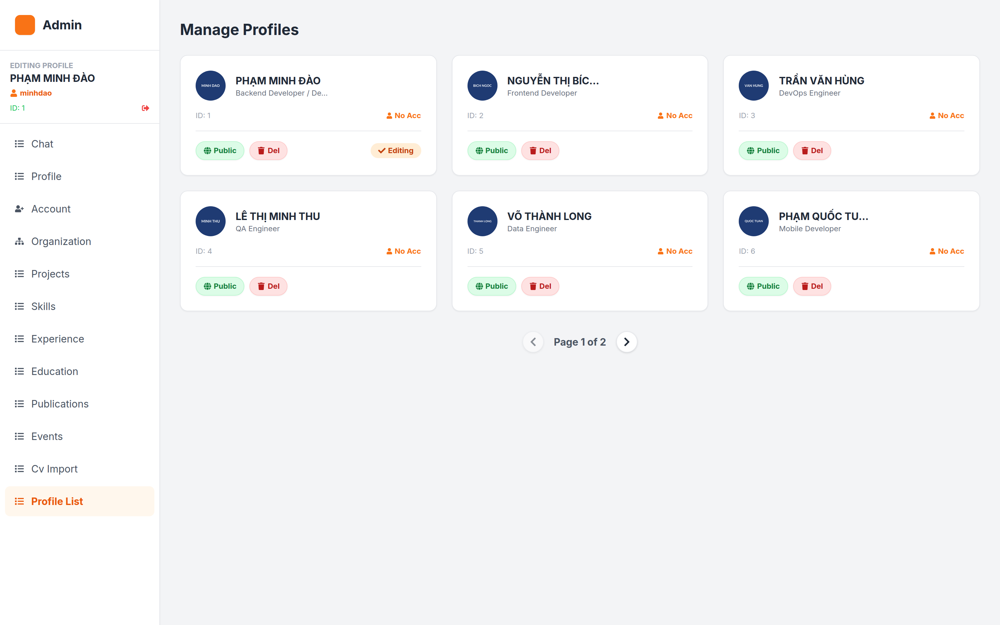
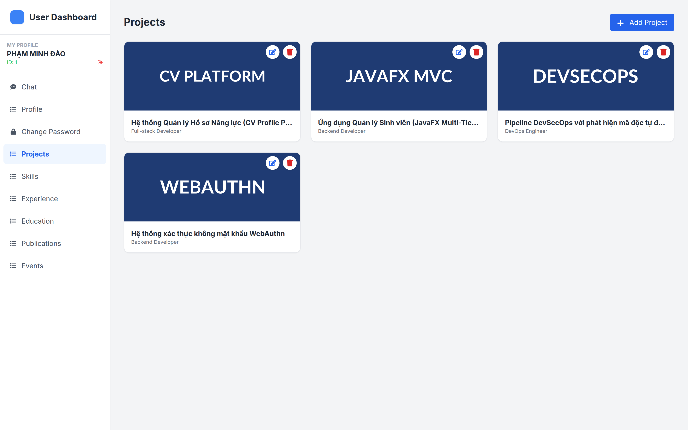

# 04 — KIỂM TRA & BÀN GIAO

> **Hệ thống:** PITECH LAB — Dynamic Portfolio
> **Mục đích:** Hỗ trợ nghiệm thu, ghi nhận trạng thái chất lượng và kế hoạch khắc phục

---

## 1. Nhật ký kiểm chứng

Các bước dưới đây đã được **thực thi thật** trên môi trường bàn giao.

| # | Hạng mục | Lệnh / thao tác | Kết quả | Trạng thái |
|---|---|---|---|---|
| V-01 | Clone mã nguồn | `git clone https://github.com/dao24092004/pitechlab-cv-profile.git` | Thành công, nhánh `main` @ `886de4b` | ✅ |
| V-02 | Kiểm tra môi trường | `node -v` / `npm -v` | Node v22.22.1, npm 9.2.0 | ✅ |
| V-03 | Cài dependencies | `npm install` | 180 package, `EXIT=0`, có cảnh báo `EBADENGINE` | ✅ |
| V-04 | Build production | `npm run build` | `✓ 1151 modules transformed` → `✓ built in 3.34s` | ✅ |
| V-05 | Kiểm tra bundle | Kiểm tra `dist/assets/` | JS 1.609 MB (gzip 460 KB), CSS **0.24 KB** | ⚠️ |
| V-06 | Dev server | `npx vite --port 3011` | `ready in 138 ms`, `curl` trả `HTTP 200` | ✅ |
| V-07 | Phân tích mã nguồn | Đọc toàn bộ 4.807 dòng / 27 file | 4 trang, 18 component, 3 service | ✅ |
| V-08 | Rà soát biến môi trường | Grep `import.meta.env` | Phát hiện `VITE_WS_URL` chưa khai báo trong `vite-env.d.ts` | ⚠️ |
| V-09 | Rà soát endpoint | Grep `api.get/post/put/delete` | 46 lời gọi REST, 8 topic/destination STOMP | ✅ |
| V-10 | Kiểm thử chức năng với backend | — | **Chưa thực hiện** — cần môi trường backend thật | ⏳ |

**Kết luận:** hệ thống **build thành công** và **dev server chạy ổn định**. Chưa có kiểm thử chức năng end-to-end vì repo không chứa backend.

---

## 2. Checklist nghiệm thu theo vai trò

### 2.1. Vai trò Khách truy cập

| # | Hạng mục | Bước kiểm | Kỳ vọng | Đạt |
|---|---|---|---|---|
| K-01 | Xem hồ sơ mặc định | Mở `/#/` | Hiện "System Booting..." rồi nội dung hồ sơ | ⏳ |
| K-02 | Xem theo đường dẫn tổ chức | Mở `/#/view/MB/HN/IT/{id}` | Nội dung hồ sơ tương ứng | ⏳ |
| K-03 | URL không hợp lệ | Mở `/#/view/XX/YY/{id}` không tồn tại | Thông báo "Connection Error / Invalid Profile URL" | ⏳ |
| K-04 | Section ẩn theo dữ liệu | Hồ sơ không có `publications` | Section "Nghiên cứu" không hiển thị | ⏳ |
| K-05 | Chuyển ngôn ngữ | Bấm cờ EN | Trang reload, nhãn sang tiếng Anh | ⏳ |
| K-06 | Chế độ tối | Bấm công tắc | Đổi nền sáng/tối, mượt 700ms | ⏳ |
| K-07 | Modal dự án | Bấm thẻ dự án | Mở modal; Esc đóng được; khoảng cuộn bị khoá | ⏳ |
| K-08 | Xem thêm | Bấm "Xem thêm ↓" | Thêm 3 dự án / 5 kinh nghiệm; bộ đếm cập nhật | ⏳ |
| K-09 | In CV | Bấm "DOWNLOAD CV" | Hộp thoại in; bố cục A4 đúng; tên file `{Tên}_Portfolio` | ⏳ |
| K-10 | Chat | Mở widget → gửi tin | Tin hiển thị ngay; Admin nhận được | ⏳ |
| K-11 | Gọi video | Bấm nút camera | Cho phép quyền; Admin nhận thông báo; có hình 2 chiều | ⏳ |
| K-12 | Ảnh lỗi | Hồ sơ có `avatarUrl` hỏng | Hiện placeholder | ⏳ |

### 2.2. Vai trò Admin

<!--SHOT-DONE:<!--SHOT:admin-profile-list-->-->

**Hiện thực chức năng công khai / xóa hồ sơ**

> Kiểm chứng mục A-05: nút Public trong tab `profile-list` đưa hồ sơ sang trạng thái công khai, nút Del xóa hồ sơ kèm hộp thoại xác nhận.

| # | Hạng mục | Bước kiểm | Kỳ vọng | Đạt |
|---|---|---|---|---|
| A-01 | Đăng nhập | `/login` với tài khoản ADMIN | Lưu token/role; chuyển `/admin` | ⏳ |
| A-02 | Danh sách hồ sơ | Tab `profile-list` | Lưới thẻ; phân trang 6/trang; "Page n of m" | ⏳ |
| A-03 | Chuyển hồ sơ | Bấm vào thẻ | Form chuyển sang hồ sơ đó; tab đổi sang `profile` | ⏳ |
| A-04 | Công khai | Nút **Public** | Có xác nhận; sau đó hồ sơ truy cập được công khai | ⏳ |
| A-05 | Xóa hồ sơ | Nút **Del** | Cảnh báo "không thể hoàn tác"; xóa và cập nhật danh sách | ⏳ |
| A-06 | Sửa thông tin chung | Tab `profile` | Lưu họ tên/chức danh/email/ảnh; nút Save hoạt động | ⏳ |
| A-07 | Tạo tài khoản | Tab `account` (hồ sơ chưa có username) | Đăng ký thành công; chuyển sang chế độ "đổi mật khẩu" | ⏳ |
| A-08 | Đổi mật khẩu (Admin) | Tab `account` (đã có username) | **Hiện chỉ báo "cần API backend"** — xem KN-01 | ❌ |
| A-09 | Gán tổ chức | Tab `organization` → chọn 3 cấp | Link sinh đúng; nút "Confirm Assignment" lưu được | ⏳ |
| A-10 | Lọc phụ thuộc | Chọn Vùng → xem danh sách Chi nhánh | Chỉ hiện chi nhánh thuộc Vùng đó | ⏳ |
| A-11 | CRUD tổ chức | Thêm/sửa/xóa Vùng, Chi nhánh, Phòng ban | Mã tự uppercase; xóa có xác nhận | ⏳ |
| A-12 | CRUD dự án | Tab `projects` | Thêm/sửa/xóa; upload ảnh; tách tech stack bằng `,` | ⏳ |
| A-13 | CRUD kỹ năng | Tab `skills` | Chọn category; nhập proficiency 0–100 | ⏳ |
| A-14 | CRUD kinh nghiệm | Tab `experience` | Tick "Present" → khóa endDate | ⏳ |
| A-15 | Nhập CV | Tab `cv-import` | Upload `.pdf`/`.docx` → spinner → tạo hồ sơ mới | ⏳ |
| A-16 | Trả lời chat | Tab `chat` | Tin Admin căn phải; khách nhận được | ⏳ |
| A-17 | Đếm chưa đọc | Nhận tin khi đang ở tab khác | `unreadCount` tăng | ⏳ |
| A-18 | Nhận cuộc gọi | Khách gọi video | Thông báo góc phải trên; bấm nhận → mở màn hình video | ⏳ |
| A-19 | Đăng xuất | Nút logout sidebar | `localStorage.clear()` → về `/login` | ⏳ |

### 2.3. Vai trò User

<!--SHOT-DONE:<!--SHOT:user-projects-->-->

**Hiện thực chức năng người dùng tự quản lý dự án**

> Kiểm chứng mục U-03: thêm / sửa / xóa dự án trong tab `projects` của trang `/user`.

| # | Hạng mục | Bước kiểm | Kỳ vọng | Đạt |
|---|---|---|---|---|
| U-01 | Đăng nhập | `/login` với tài khoản USER | Chuyển `/user`; `profileId` lưu vào localStorage | ⏳ |
| U-02 | Hồ sơ của tôi | Tab `profile` | Chỉ hiện dữ liệu của chính mình | ⏳ |
| U-03 | Tiêu đề 2 dòng | Nhập `Dòng 1 \| Dòng 2` | Trang hiển thị 2 dòng | ⏳ |
| U-04 | Link chia sẻ | Tab `profile` | Link đúng cấu tổ chức; copy được | ⏳ |
| U-05 | CRUD dữ liệu | Các tab `projects`... | Thêm/sửa/xóa chỉ trong phạm vi hồ sơ mình | ⏳ |
| U-06 | Đổi mật khẩu | Tab `change-password` | Sai xác nhận → cảnh báo; đúng → thông báo thành công | ⏳ |
| U-07 | Chat | Tab `chat` | Subscribe `/topic/private/{profileId}`; gửi tin được | ⏳ |
| U-08 | Gọi video | Nút camera trên phiên chat | `roomId` dạng `call-...` — xem KN-08 | ⏳ |

### 2.4. Kiểm thử phi chức năng

| # | Hạng mục | Kỳ vọng | Đạt |
|---|---|---|---|
| N-01 | Route `/admin` không token | Redirect `/login` | ⏳ |
| N-02 | Route `/user` không token | Redirect `/login` | ⏳ |
| N-03 | Route lạ (`/xyz`) | Redirect `/` | ⏳ |
| N-04 | Backend trả lỗi 500 | Màn hình "Connection Error..." | ⏳ |
| N-05 | Token hết hạn | **Không có xử lý 401 tập trung** — xem KN-02 | ❌ |
| N-06 | Mất mạng giữa chừng | STOMP tự reconnect sau 5s | ⏳ |
| N-07 | Hồ sơ có mảng rỗng ở mọi section | Trang vẫn render, không lỗi JS | ⏳ |
| N-08 | `description` chứa ký tự HTML | **Render thẳng, không sanitize** — xem KN-05 | ❌ |
| N-09 | Tải ảnh rất lớn (>5 MB) | Không có kiểm tra kích thước phía client | ⚠️ |
| N-10 | Build production | `npm run build` thành công | ✅ |

---

## 3. Danh sách khiếm khuyết đã biết

Mã đánh dấu: 🔴 nghiêm trọng · 🟠 trung bình · 🟡 nhỏ · ⚪ ghi nhận

### 3.1. Kiến trúc & cấu hình

| ID | Mức | Vấn đề | Vị trí | Tác động |
|---|---|---|---|---|
| KN-01 | 🔴 | **Tab `account` của Admin chưa nối API đổi mật khẩu** — chỉ hiện thông báo "cần API backend hỗ trợ" | `pages/Admin.tsx` | Admin không thể đặt lại mật khẩu cho nhân sự. Cần backend hỗ trợ endpoint đổi mật khẩu theo `profileId`. |
| KN-02 | 🔴 | **Không có xử lý 401 tập trung** — token hết hạn thì mọi request fail im lặng, người dùng không được đưa về `/login` | `services/api.ts` | UX kém. Nên thêm interceptor `response` bắt 401 → `localStorage.clear()` → `navigate('/login')`. |
| KN-03 | 🔴 | **Tailwind không được build** — thiếu dependency `tailwindcss`, thiếu `postcss.config.js`, thiếu plugin PostCSS; CSS build ra chỉ 0,24 KB chứa nguyên directive | `package.json`, `index.css` | Toàn bộ giao diện phụ thuộc CDN. Mất mạng → mất style. Flash of unstyled content. Rủi ro XSS từ CDN. Xem [03 — mục 7.2](./03-HUONG-DAN-CAI-DAT-VA-SU-DUNG.md). |
| KN-04 | 🟠 | **Hai nguồn cấu hình Tailwind cùng tồn tại** — `tailwind.config.js` khai báo `canva-*`; `index.html` nạp CDN với config riêng chỉ có `canva-*` | `tailwind.config.js`, `index.html` | CDN config ghi đè theme; các utility ngoài danh sách CDN có thể không được sinh → mất định dạng. Cần chuẩn hóa về một nguồn. |
| KN-05 | 🟠 | **Nội dung người dùng không được sanitize** — `description`, `bio`, `title` render thẳng vào JSX | `pages/Home.tsx`, `pages/Admin.tsx`, `pages/User.tsx` | Nguy cơ XSS nếu backend không lọc. Nên sanitize phía server (ưu tiên) hoặc dùng thư viện như DOMPurify. |
| KN-06 | 🟡 | **`VITE_WS_URL` không khai báo trong `vite-env.d.ts`** — chỉ có `VITE_API_URL` | `vite-env.d.ts` | TypeScript không gợi ý biến này → dễ quên khai báo khi cấu hình. Nên bổ sung `readonly VITE_WS_URL: string;`. |
| KN-07 | ⚪ | **Importmap ESM còn sót trong `index.html`** và vẫn được giữ trong `dist/index.html` | `index.html` | Không gây lỗi nhưng gây nhầm lẫn; có thể xóa an toàn. |
| KN-08 | ⚪ | **Hai quy ước `roomId` khác nhau** — khách tạo `room-{visitorId}-{ts}`, User chủ động gọi tạo `call-{profileId}-{visitorId}-{ts}` | `components/ChatWidget.tsx`, `pages/User.tsx` | Cần backend xác nhận xử lý được cả hai dạng. |

### 3.2. Tính năng chưa hoàn thiện

| ID | Mức | Vấn đề | Vị trí | Tác động |
|---|---|---|---|---|
| KN-09 | 🟠 | **`getChatHistory()` khai báo nhưng không gọi** — không có lịch sử chat | `services/api.ts` | Reload trang là mất toàn bộ lịch sử hội thoại với khách. Nên gọi `GET /chat/history` khi mở widget. |
| KN-10 | 🟡 | **`downloadCV()` khai báo nhưng không gọi** — nút tải CV dùng cơ chế in phía client | `services/api.ts` | Endpoint `/export/cv-data` có thể thừa hoặc chưa được dùng. Cần backend xác nhận. |
| KN-11 | 🟡 | **`getPortfolioByDepartment()` không được gọi** — trùng endpoint với `getPortfolioByHierarchyCodes()` | `services/api.ts` | Cần backend xác nhận endpoint `/view/code/{r}/{l}/{d}/{pid}` là đúng cho cả hai trường hợp. |
| KN-12 | 🟡 | **`getProjectDetail()` không được gọi** | `services/api.ts` | |
| KN-13 | 🟡 | **Ô nhập thiếu cho một số trường có trong model** — `github`, `linkedin`, `location` (Contact), `demoUrl`, `gallery` (Project), `strengths`, `workStyle` | `pages/Admin.tsx`, `pages/User.tsx` | Người dùng không thể nhập các thông tin này dù API trả về và trang công khai hiển thị. |
| KN-14 | 🟡 | **Ô tìm kiếm phiên chat không có logic lọc** | `pages/User.tsx` | UI gợi ý có chức năng nhưng không hoạt động. |
| KN-15 | ⚪ | **Không lưu lịch sử chat phía client** | `components/ChatWidget.tsx` | Phụ thuộc backend lưu lịch sử. |
| KN-16 | ⚪ | **Trạng thái chế độ tối không được lưu** | `pages/Home.tsx` | Reload trang → về sáng. |
| KN-17 | 🟡 | **Đa ngôn ngữ chỉ phủ một phần** — nhãn "Xem thêm", chuỗi đếm kinh nghiệm, toàn bộ nhãn form, nhãn tab quản trị vẫn tiếng Việt cố định | `utils/translations.ts` | Trải nghiệm song ngữ chưa hoàn chỉnh. |
| KN-18 | ⚪ | **Số điện thoại hard-code `0904 140 022`** thay vì lấy từ `data.contact.phone` | `pages/Home.tsx` | Hiển thị sai số nếu hồ sơ khác. Lỗi rõ ràng nên sửa. |
| KN-19 | ⚪ | **Không có kiểm thử tự động** (0 test) | — | Không có đường hồi quy cho hồ sơ chức năng mới. |
| KN-20 | ⚪ | **Không có ESLint/Prettier** | — | Không có quy chuẩn tự động cho code style. |

### 3.3. Chất lượng & hiệu năng

| ID | Mức | Vấn đề | Tác động |
|---|---|---|---|
| KN-21 | 🟠 | **Bundle 1,6 MB (460 KB gzip), cảnh báo chunk > 500 KB** | Toàn bộ `three.js` nằm trong bundle chính. Nên `React.lazy` cho `TechScene` hoặc chia chunk thủ công. |
| KN-22 | 🟡 | **`Home.tsx` (633 dòng) và `Admin.tsx` (876 dòng) quá lớn** | Khó bảo trì. Nên tách modal, tab, hook thành component riêng. |
| KN-23 | 🟡 | **`Admin.tsx` lặp lại gần như nguyên vẹn khối CRUD của `User.tsx`** | Sửa một chỗ phải sửa hai chỗ. Nên tách `useCrud` hook hoặc component dùng chung. |
| KN-24 | 🟡 | **Nhiều lời gọi `alert()` thay vì thông báo đẹp** | `react-hot-toast` đã cài nhưng **chưa dùng**. UX không nhất quán. |
| KN-25 | 🟡 | **`useEffect` của `Admin.tsx` thiếu dependency** — `fetchInitialData` đọc `portfolioData` nhưng không nằm trong mảng phụ thuộc | Cảnh báo exhaustive-deps; có thể dẫn tới hành vi không mong muốn khi đổi trang. |
| KN-26 | ⚪ | **`StrictMode` nhân đôi effect ở chế độ dev** | Mở 2 kết nối STOMP, fetch 2 lần, tin chat nhận trùng. Không ảnh hưởng production. |
| KN-27 | ⚪ | **`Environment preset` của three.js tải asset từ CDN ngoài** | Phụ thuộc mạng; có thể chậm. Cân nhắc tự chứa asset. |
| KN-28 | ⚪ | **Nhiều dùng `any`** ở `education`, `publication`, `event`, `editingProfile` | Mất an toàn kiểu dữ liệu — nên định nghĩa interface đầy đủ trong `types/index.ts`. |
| KN-29 | ⚪ | **`avatarUrl` trong bản in dùng `via.placeholder.com`** (dịch vụ đã ngừng hoạt động) | Ảnh dự phòng không hiện. Nên đổi sang `placehold.co` như phần còn lại của dự án. |

### 3.4. Vấn đề về mô hình dữ liệu

| ID | Mức | Vấn đề | Chi tiết |
|---|---|---|---|
| KN-30 | 🟠 | **Form `Education` gửi `schoolName` nhưng client đọc `school`** | `mapBackendToFrontend` đọc `e.school` và `e.period`; form Admin/User dùng `schoolName` và không có `period`. Nếu backend lưu đúng tên form thì mục Học vấn sẽ trống. **Cần xác nhận với backend.** |
| KN-31 | ⚪ | **`WorkExperience` có cả `endDate` và `isCurrent`** | `endDate` mặc định "Present" khi thiếu; `isCurrent` lại quyết định hiển thị. Hai nguồn sự thật trùng lặp. |

---

## 4. Kế hoạch khắc phục

### 4.1. Giai đoạn 1 — Chặn (nên làm ngay)

| # | Hạng mục | ID | Ước lượng |
|---|---|---|---|
| 1 | Thêm Tailwind vào build pipeline, bỏ CDN | KN-03, KN-04 | 0,5–1 ngày |
| 2 | Xử lý 401 toàn cục → đăng nhập lại | KN-02 | 0,5 ngày |
| 3 | Nối API đổi mật khẩu cho Admin (cần backend) | KN-01 | 0,5 ngày FE + BE |
| 4 | Khai báo `VITE_WS_URL` trong `vite-env.d.ts`; chuẩn hóa URL WS | KN-06 | 15 phút |
| 5 | Dùng `data.contact.phone` thay số hard-code | KN-18 | 10 phút |

### 4.2. Giai đoạn 2 — Ổn định

| # | Hạng mục | ID | Ước lượng |
|---|---|---|---|
| 6 | Gọi `GET /chat/history` khi mở widget chat | KN-09 | 0,5 ngày |
| 7 | Bổ sung ô nhập `github`, `linkedin`, `demoUrl`, `gallery`, `strengths`, `workStyle` | KN-13 | 0,5 ngày |
| 8 | Bật lọc cho ô tìm kiếm phiên chat | KN-14 | 0,5 ngày |
| 9 | Thay `alert()` bằng `react-hot-toast` | KN-24 | 1 ngày |
| 10 | Xác nhận & thống nhất tên trường `Education` với backend | KN-30 | 0,5 ngày |
| 11 | Bật `strict` của TypeScript để phát hiện `any` | KN-28 | 1–2 ngày |

### 4.3. Giai đoạn 3 — Nâng cao chất lượng

| # | Hạng mục | ID | Ước lượng |
|---|---|---|---|
| 12 | Thêm ESLint + Prettier, sửa các vi phạm | KN-20, KN-25 | 1 ngày |
| 13 | Viết unit test cho `mapBackendToFrontend`, `generateShareLink` | KN-19 | 1–2 ngày |
| 14 | Viết E2E test cho luồng đăng nhập + CRUD | KN-19 | 2–3 ngày |
| 15 | Tách `Home.tsx`, `Admin.tsx` thành component con | KN-22 | 2–3 ngày |
| 16 | Tách hook CRUD dùng chung Admin/User | KN-23 | 1–2 ngày |
| 17 | `React.lazy` + code splitting cho `TechScene` | KN-21 | 0,5 ngày |
| 18 | Hoàn thiện đa ngôn ngữ | KN-17 | 1–2 ngày |
| 19 | Sanitize nội dung người dùng | KN-05 | 0,5 ngày FE (+ BE) |

### 4.4. Hạng mục phụ thuộc hạ tầng

| # | Hạng mục | ID | Ghi chú |
|---|---|---|---|
| 20 | Triển khai TURN server (coturn) | — | Bắt buộc cho gọi video qua mạng công ty/di động. Xem [03 — mục 7.6](./03-HUONG-DAN-CAI-DAT-VA-SU-DUNG.md). |
| 21 | Xác nhận endpoint `/export/cv-data` | KN-10 | Backend còn giữ hay bỏ? |
| 22 | Xác nhận format `/view/code/{r}/{l}/{d}/{pid}` | KN-11 | Dùng cho cả 2 và 3 cấp? |
| 23 | Xác nhận backend đã lọc nội dung người dùng | KN-05 | |

---

## 5. Danh mục tài liệu cần cung cấp thêm

| Tài liệu | Trạng thái | Bắt buộc |
|---|---|---|
| Tài liệu đặc tả API (OpenAPI/Swagger) | ❌ Chưa có | ✅ |
| Sơ đồ CSDL (ERD) | ❌ Chưa có | ✅ |
| Tài liệu quản trị hệ thống | ❌ Chưa có | 🟠 |
| Hướng dẫn vận hành hạ tầng (deploy, backup, monitoring) | ❌ Chưa có | 🟠 |
| Kế hoạch bảo trì / SLA | ❌ Chưa có | 🟠 |
| Quy trình phát hành (release process) | ❌ Chưa có | 🟡 |

---

## 6. Quy trình bàn giao

### 6.1. Checklist bàn giao

| # | Hạng mục | Đạt |
|---|---|---|
| 1 | Mã nguồn trên Git, nhánh `main` là bản ổn định | ✅ |
| 2 | Bộ tài liệu trong `docs/` (5 tài liệu) | ✅ |
| 3 | `README.md` cập nhật hướng dẫn chạy nhanh | ✅ |
| 4 | `.env.example` mô tả biến môi trường | ✅ |
| 5 | Quy trình build & deploy viết rõ | ✅ |
| 6 | Danh sách khiếm khuyết đã biết đầy đủ | ✅ |
| 7 | Kế hoạch khắc phục có phân giai đoạn | ✅ |
| 8 | Danh sách hạng mục cần backend xác nhận | ✅ |
| 9 | Tài liệu API backend | ❌ Yêu cầu từ backend |
| 10 | Môi trường staging dùng để nghiệm thu | ❌ Cần triển khai |

### 6.2. Người tiếp nhận

| Vai trò | Trách nhiệm |
|---|---|
| **Quản trị dự án** | Quyết định ưu tiên các hạng mục trong kế hoạch khắc phục; điều phối với backend |
| **Backend** | Cung cấp tài liệu API; xác nhận các điểm mơ hồ; triển khai TURN server |
| **Frontend** | Xử lý giai đoạn 1–3; thêm kiểm thử; tối ưu bundle |
| **QA** | Chạy checklist tại [mục 2](./04-KIEM-TRA-VA-BAN-GIAO.md) trên staging; đánh dấu kết quả |

### 6.3. Điều kiện nghiệm thu

Hệ thống được coi là nghiệm thu đạt khi:

1. ✅ Build production thành công (đã kiểm chứng).
2. ✅ Dev server chạy ổn định (đã kiểm chứng).
3. ⏳ Tất cả mục checklist tại [mục 2](./04-KIEM-TRA-VA-BAN-GIAO.md) được kiểm tra và đạt trên staging.
4. ⏳ Các hạng mục 🔴 trong [mục 3.1](./04-KIEM-TRA-VA-BAN-GIAO.md) đã xử lý hoặc được chấp nhận rủi ro bằng văn bản.
5. ⏳ Backend cung cấp tài liệu API và xác nhận các điểm mơ hồ tại [mục 3.4](./04-KIEM-TRA-VA-BAN-GIAO.md).

---

## 7. Phụ lục — Điểm cần backend xác nhận

Tổng hợp các câu hỏi cần gửi backend:

| # | Câu hỏi | Liên quan |
|---|---|---|
| 1 | Endpoint `/api/v1/export/cv-data` còn tồn tại và được dùng không? | KN-10 |
| 2 | `GET /api/v1/chat/history` trả về dữ liệu theo định danh khách hay theo profile? | KN-09 |
| 3 | `GET /api/v1/view/code/{r}/{l}/{d}/{pid}` dùng cho cả trường hợp 2 cấp và 3 cấp? | KN-11 |
| 4 | Entity Education lưu trường `school` hay `schoolName`? Có trường `period` không? | KN-30 |
| 5 | API `/admin/profile` (PUT) có nhận `contact.github`, `contact.linkedin`, `contact.location` không? | KN-13 |
| 6 | API tạo/chỉnh sửa Project có nhận `demoUrl`, `gallery` không? | KN-13 |
| 7 | Có endpoint đổi mật khẩu theo `profileId` cho Admin không? | KN-01 |
| 8 | Backend có lọc/sanitize nội dung người dùng (`description`, `bio`) không? | KN-05 |
| 9 | Topic `/topic/call-requests/{profileId}` có dùng cho cả định dạng `room-*` và `call-*` không? | KN-08 |
| 10 | Phân quyền cho `/user/**` được thực thi thế nào (theo `profileId` trong token hay body)? | BR-11 |
| 11 | `POST /upload` giới hạn kích thước và loại file ra sao? | N-09 |
| 12 | Có giới hạn tần suất gửi tin nhắn chat không? | BR-17 |

---

Tiếp theo: [05 — Phụ lục kỹ thuật](./05-PHU-LUC-KY-THUAT.md)
