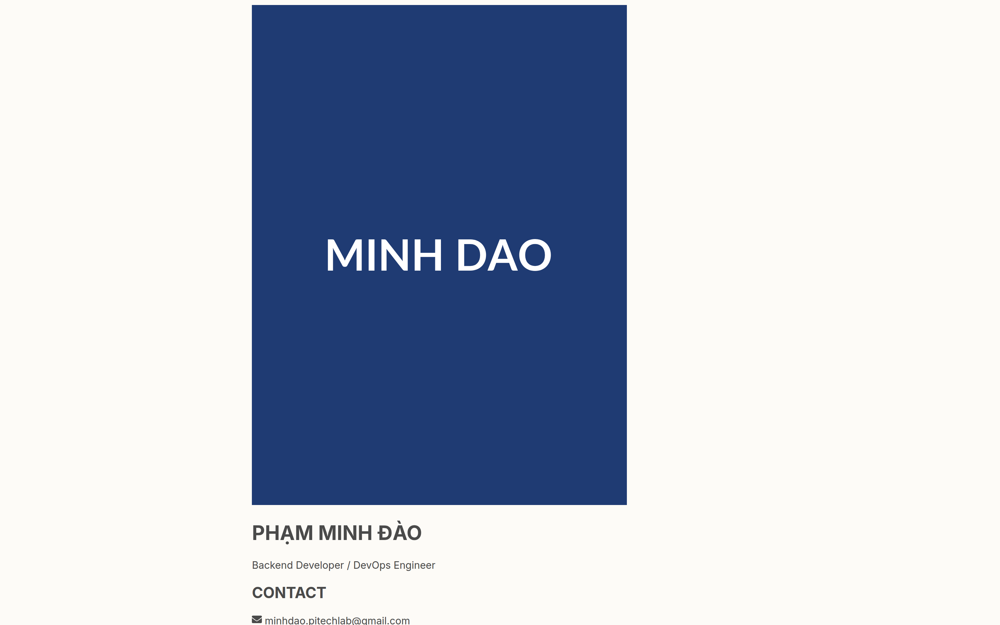

# 05 — PHỤ LỤC KỸ THUẬT

> **Hệ thống:** PITECH LAB — Dynamic Portfolio
> **Dành cho:** Lập trình viên, kỹ sư vận hành

---

## 1. Danh mục dependency

### 1.1. Dependency runtime

| Package | Phiên bản | Vai trò | Có dùng không |
|---|---|---|---|
| `react` | ^19.2.3 | Thư viện giao diện | ✅ |
| `react-dom` | ^19.2.3 | Gắn React vào DOM | ✅ |
| `react-router-dom` | ^7.11.0 | Định tuyến | ✅ `HashRouter` |
| `axios` | ^1.13.2 | HTTP client | ✅ |
| `framer-motion` | ^12.23.26 | Animation | ✅ |
| `@stomp/stompjs` | ^7.2.1 | Client STOMP | ✅ |
| `sockjs-client` | ^1.6.1 | WebSocket fallback (SockJS) | ✅ |
| `three` | ^0.182.0 | WebGL 3D | ✅ `TechScene` |
| `@react-three/fiber` | ^9.5.0 | React renderer cho three.js | ✅ |
| `@react-three/drei` | ^10.7.7 | Thành phần 3D dựng sẵn | ✅ |
| `@types/three` | ^0.182.0 | Kiểu dữ liệu three.js | ✅ *(dev, nhưng nằm trong `dependencies`)* |
| `react-icons` | ^5.5.0 | Icon Font Awesome | ✅ |
| `react-to-print` | ^3.2.0 | Xuất bản in | ✅ |
| `react-hot-toast` | ^2.6.0 | Thông báo | ⚠️ **Đã cài, chưa dùng** |

### 1.2. Dependency dev

| Package | Phiên bản | Vai trò |
|---|---|---|
| `vite` | ^6.2.0 | Build tool + dev server |
| `@vitejs/plugin-react` | ^5.0.0 | Plugin React cho Vite |
| `typescript` | ~5.8.2 | Kiểm tra kiểu (không emit) |
| `@types/node` | ^22.19.3 | Kiểu dữ liệu Node cho `vite.config.ts` |

### 1.3. Dependency **còn thiếu**

| Package | Lý do cần |
|---|---|
| `tailwindcss` | Không có → Tailwind không được build (xem [KN-03](./04-KIEM-TRA-VA-BAN-GIAO.md)) |
| `postcss` + `autoprefixer` | Bộ xử lý CSS cho Tailwind |
| `eslint` + plugin | Chưa có lint |
| `prettier` | Chưa có format |
| `vitest` / `jest` | Chưa có test |

---

## 2. Danh mục endpoint REST

Base URL: `{VITE_API_URL}/api/v1` (trừ `/auth/login` dùng `{VITE_API_URL}/api/v1/auth/login` — cùng đường dẫn).

> **Lưu ý:** bảng này ghi nhận endpoint **frontend đang gọi**, dựa trên mã nguồn. Trạng thái cột "Gọi" cho biết hàm có thực sự được dùng hay không.


<!--SHOT-DONE:<!--SHOT:home-hero-->-->


**Giao diện trang công khai — tham chiếu cho mô hình dữ liệu**

> Dữ liệu hiển thị trên trang này ánh xạ trực tiếp từ payload `GET /api/v1/portfolio` qua hàm `mapBackendToFrontend` trong `services/api.ts`.


### 2.1. Portfolio (công khai)

| Method | Đường dẫn | Hàm gọi | Gọi từ | Trạng thái |
|---|---|---|---|---|
| GET | `/portfolio` | `getPortfolioData` | `Home` | ✅ |
| GET | `/admin/portfolio/{id}` | `getPortfolioById` | `Home`, `Admin` | ✅ |
| GET | `/view/{regionCode}/{pid}` | `getPortfolioByRegion` | `Home` | ✅ |
| GET | `/view/code/{r}/{l}/{d}/{pid}` | `getPortfolioByHierarchyCodes` | `Home` | ✅ |
| GET | `/view/code/{r}/{l}/{d}/{pid}` | `getPortfolioByDepartment` | — | ❌ trùng endpoint |
| GET | `/view/{r}/{l}/{pid}` | `getPortfolioByLocalOrg` | `Home` | ✅ |
| GET | `/export/cv-data` | `downloadCV` | — | ❌ dùng `window.open` |
| GET | `/chat/history` | `getChatHistory` | — | ❌ |

### 2.2. Xác thực

| Method | Đường dẫn | Body | Gọi từ |
|---|---|---|---|
| POST | `/auth/login` | `{ username, password }` | `Login.tsx` (axios trực tiếp) |
| POST | `/auth/register` | `{ profileId, fullName, username, password }` | `Admin.tsx` (axios trực tiếp) |
| POST | `/auth/change-password` | `{ currentPassword, newPassword, confirmPassword }` | `User.tsx` (axios trực tiếp) |

### 2.3. Quản trị

| Method | Đường dẫn | Ghi chú |
|---|---|---|
| GET | `/admin/list?page={p}&size=6` | Trả `{ content[], totalPages }` |
| GET | `/admin/portfolio/{id}` | Dùng chung với portfolio công khai |
| PUT | `/admin/profile` | Cập nhật hồ sơ; cũng dùng để **gán tổ chức** |
| DELETE | `/admin/profile/{id}` | Xóa hồ sơ |
| POST | `/admin/profile/{id}/activate` | Công khai hồ sơ |
| POST | `/admin/projects` | Thêm dự án |
| PUT | `/admin/projects/{id}` | Sửa dự án |
| DELETE | `/admin/projects/{id}` | Xóa dự án |
| POST/PUT/DELETE | `/admin/skills[/{id}]` | Kỹ năng |
| POST/PUT/DELETE | `/admin/experiences[/{id}]` | Kinh nghiệm |
| POST/PUT/DELETE | `/admin/educations[/{id}]` | Học vấn |
| POST/PUT/DELETE | `/admin/publications[/{id}]` | Công bố |
| POST/PUT/DELETE | `/admin/events[/{id}]` | Sự kiện |
| GET | `/admin/projects/{id}` | `getProjectDetail` — ❌ chưa gọi |

### 2.4. Tổ chức

| Method | Đường dẫn | Body / tham số |
|---|---|---|
| GET | `/org/regions` | → `Region[]` |
| POST | `/org/regions` | `{ name, code }` |
| PUT | `/org/regions/{id}` | `{ name, code }` |
| DELETE | `/org/regions/{id}` | |
| GET | `/org/locals` | → `LocalOrg[]` |
| POST | `/org/locals` | `{ name, code, regionId }` |
| PUT | `/org/locals/{id}` | `{ name, code, regionId }` |
| DELETE | `/org/locals/{id}` | |
| GET | `/org/departments` | → `Department[]` |
| POST | `/org/departments` | `{ name, code, localOrgId }` |
| PUT | `/org/departments/{id}` | `{ name, code, localOrgId }` |
| DELETE | `/org/departments/{id}` | |

### 2.5. Người dùng

| Method | Đường dẫn | Ghi chú |
|---|---|---|
| GET | `/user/profile` | Có thể trả **mảng** hoặc **object** — client xử lý cả hai |
| PUT | `/user/profile` | |
| GET | `/user/projects/{id}` | `getProject` — ❌ chưa gọi |
| GET | `/user/skills/{id}` | `getSkill` — ❌ chưa gọi |
| GET | `/user/experiences/{id}` | `getExperience` — ❌ chưa gọi |
| GET | `/user/educations/{id}` | `getEducation` — ❌ chưa gọi |
| GET | `/user/publications/{id}` | `getPublication` — ❌ chưa gọi |
| GET | `/user/events/{id}` | `getEvent` — ❌ chưa gọi |
| POST/PUT/DELETE | `/user/projects[/{id}]` | |
| POST/PUT/DELETE | `/user/skills[/{id}]` | |
| POST/PUT/DELETE | `/user/experiences[/{id}]` | |
| POST/PUT/DELETE | `/user/educations[/{id}]` | |
| POST/PUT/DELETE | `/user/publications[/{id}]` | |
| POST/PUT/DELETE | `/user/events[/{id}]` | |
| POST | `/user/import-cv` | `importCV` — ❌ chưa gọi |

### 2.6. Tệp tin

| Method | Đường dẫn | Content-Type | Ghi chú |
|---|---|---|---|
| POST | `/upload` | `multipart/form-data` (field `file`) | Trả về URL dạng chuỗi |
| POST | `/admin/import-cv` | `multipart/form-data` (field `file`) | Nhập CV bằng AI |

---

## 3. Danh mục topic & destination STOMP

### 3.1. Destination (client → server)

| Destination | Payload | Gửi từ | Ý nghĩa |
|---|---|---|---|
| `/app/chat.sendToAdmin` | `{ sender, senderId, content, type, timestamp }` | `ChatWidget` | Khách gửi tin nhắn cho quản trị |
| `/app/chat.replyToUser` | `{ sender, senderId, recipientId, content, type, timestamp }` | `Admin`, `User` | Trả lời tin nhắn |
| `/app/video.request` | `{ roomId, visitorName }` | `ChatWidget` | Khách yêu cầu gọi video |
| `/app/video.signal` | `{ type, data, from, roomId }` | `VideoCallInterface` | Báo hiệu WebRTC (offer/answer/ICE/end-call) |

### 3.2. Topic (server → client)

| Topic | Nội dung | Subscribe từ |
|---|---|---|
| `/topic/public/updates` | Chuỗi `"PROFILE_UPDATED"` | `Home` — kích hoạt tải lại hồ sơ |
| `/topic/private/{visitorId}` | `ChatMessage` | `ChatWidget` (khách), `User` (`{profileId}`) |
| `/topic/private/{profileId}` | `ChatMessage` | `User` |
| `/topic/admin/messages` | `ChatMessage` | `Admin` |
| `/topic/call-requests` | `{ roomId, visitorName }` | `Admin` |
| `/topic/call-requests/{profileId}` | `{ roomId, visitorName }` | `User` |
| `/topic/video/{roomId}` | Tín hiệu WebRTC | `VideoCallInterface` |

### 3.3. Cấu hình kết nối STOMP

| Tham số | Giá trị | Nơi đặt |
|---|---|---|
| `webSocketFactory` | `() => new SockJS(VITE_WS_URL)` | Mọi component dùng STOMP |
| `reconnectDelay` | `5000` ms | `ChatWidget`, `Admin`, `User`, `VideoCallInterface` |

> **Bất nhất:** `Home.tsx` tạo SockJS từ `${API_BASE_URL}/ws`, còn lại dùng `VITE_WS_URL`. Trong production hai giá trị này phải trùng nhau.

### 3.4. Định dạng message chat

```typescript
interface ChatMessage {
  sender: string;      // Tên hiển thị ("Guest a1b2" hoặc "Admin")
  senderId: string;    // Định danh người gửi — dùng để định tuyến
  recipientId?: string; // Người nhận (chỉ có trong tin trả lời)
  content: string;
  type: 'CHAT' | 'JOIN' | 'LEAVE';
  timestamp: string;    // locale time string
}
```

### 3.5. Định dạng tín hiệu video

```typescript
{
  type: 'offer' | 'answer' | 'ice-candidate' | 'end-call',
  data: { ... },        // tuỳ type
  from: 'Admin' | 'Visitor',
  roomId: string
}
```

| `type` | `data` chứa |
|---|---|
| `offer` | `{ type: 'offer', sdp }` |
| `answer` | `{ type: 'answer', sdp }` |
| `ice-candidate` | `{ candidate, sdpMid, sdpMLineIndex }` |
| `end-call` | (không có) |

---

## 4. Biến môi trường

### 4.1. Bảng đầy đủ

| Tên | Kiểu | Bắt buộc | Mặc định | Nơi dùng |
|---|---|---|---|---|
| `VITE_API_URL` | string | ✅ | `http://localhost:8080` | `services/api.ts`, `pages/Home.tsx`, `pages/Login.tsx`, `pages/User.tsx`, `pages/Admin.tsx` |
| `VITE_WS_URL` | string | ✅ | *(không có)* | `components/ChatWidget.tsx`, `components/VideoCallInterface.tsx`, `pages/User.tsx`, `pages/Admin.tsx` |

### 4.2. Quy tắc Vite

- Chỉ biến có tiền tố `VITE_` mới được expose ra client.
- Giá trị được **nội tuyến lúc build**, không đọc được ở runtime → mỗi môi trường cần một bản build riêng.
- File ưu tiên: `.env.local` → `.env.[mode].local` → `.env.[mode]` → `.env`.

### 4.3. File môi trường theo lệnh

| Lệnh | Mode | File được đọc |
|---|---|---|
| `npm run dev` | `development` | `.env`, `.env.local`, `.env.development`, `.env.development.local` |
| `npm run build` | `production` | `.env`, `.env.production`, `.env.local`, `.env.production.local` |

### 4.4. `vite-env.d.ts` — hiện trạng

```typescript
interface ImportMetaEnv {
    readonly VITE_API_URL: string;
}
```

**Cần bổ sung:** `readonly VITE_WS_URL: string;` — xem [KN-06](./04-KIEM-TRA-VA-BAN-GIAO.md).

---

## 5. Cấu hình build

### 5.1. `vite.config.ts`

```typescript
export default defineConfig(({ mode }) => {
  const env = loadEnv(mode, '.', '');
  return {
    server: { port: 3000, host: '0.0.0.0' },
    plugins: [react()],
    define: {
      global: 'window',                                    // fix sockjs-client
      'process.env': {},                                    // tránh lỗi process undefined
      'process.env.API_KEY': JSON.stringify(env.GEMINI_API_KEY),
      'process.env.GEMINI_API_KEY': JSON.stringify(env.GEMINI_API_KEY),
    },
    resolve: { alias: { '@': path.resolve(__dirname, '.') } },
  };
});
```

| Cấu hình | Ý nghĩa |
|---|---|
| `server.port = 3000` | Cổng dev server |
| `server.host = '0.0.0.0'` | Truy cập từ mạng nội bộ |
| `define.global = 'window'` | `sockjs-client` cần `global`; `index.tsx` cũng set `(window as any).global = window` |
| `define['process.env'] = {}` | Tránh `process is not defined` ở trình duyệt |
| `alias '@'` | Trỏ về thư mục gốc → import `@/components/TechScene` |

> **Ghi chú:** `GEMINI_API_KEY` được truyền vào `define` dù frontend hiện **không dùng** Gemini. Có thể là dấu vết từ bản AI Studio. Không nên đưa khoá thật vào biến `VITE_*` vì sẽ bị lộ trong bundle.

### 5.2. `tsconfig.json`

| Cấu hình | Giá trị | Tác dụng |
|---|---|---|
| `target` | `ES2022` | Cú pháp hiện đại |
| `module` | `ESNext` | ESM |
| `moduleResolution` | `bundler` | Tương thích Vite |
| `jsx` | `react-jsx` | Không cần `import React` |
| `strict` | ⚠️ **không bật** | Cho phép `any` |
| `noEmit` | `true` | Chỉ kiểm tra kiểu, Vite lo transpile |
| `skipLibCheck` | `true` | Bỏ qua kiểm tra kiểu trong `.d.ts` |
| `paths` | `{"@/*": ["./*"]}` | Alias |

### 5.3. `tailwind.config.js`

```javascript
module.exports = {
  darkMode: 'class',
  content: ["./index.html", "./**/*.{js,ts,jsx,tsx}"],
  theme: {
    extend: {
      colors: {
        'canva-bg': '#FDFBF7', 'canva-paper': '#FFFFFF',
        'canva-primary': '#E6BAA3', 'canva-secondary': '#B5EAD7',
        'canva-accent': '#C7CEEA', 'canva-text': '#4A4A4A', 'canva-gray': '#888888'
      },
      fontFamily: { sans: ['Inter', 'sans-serif'] },
      boxShadow: { 'soft': '0 4px 20px rgba(0, 0, 0, 0.05)' }
    }
  },
  plugins: []
};
```

> **Quan trọng:** bảng màu `canva-*` **không được dùng ở bất kỳ đâu trong mã**. Giao diện thực tế dùng cyan/orange/slate mặc định. Bảng này chỉ tồn tại trong config.

### 5.4. `index.css`

```css
@tailwind base;
@tailwind components;
@tailwind utilities;

@layer utilities {
    .perspective-1000   { perspective: 1000px; }
    .transform-style-3d { transform-style: preserve-3d; }
    .backface-hidden    { backface-visibility: hidden; }
    .rotate-y-180       { transform: rotateY(180deg); }
}
```

4 utility class 3D này **được dùng thật** (`SkillFlipCard`, `AvatarBox`).

### 5.5. `index.html` — các điểm đáng chú ý

| Phần | Vai trò | Đánh giá |
|---|---|---|
| Google Fonts `Inter` 300–800 | Font chính | ✅ |
| `<script src="https://cdn.tailwindcss.com">` | Tailwind runtime | ⚠️ Xem [KN-03](./04-KIEM-TRA-VA-BAN-GIAO.md) |
| `<script> tailwind.config = {...} </script>` | Config trùng lặp, ghi đè theme | ⚠️ Xem [KN-04](./04-KIEM-TRA-VA-BAN-GIAO.md) |
| `<style> body { ... } ::-webkit-scrollbar {...} </style>` | Nền + thanh cuộn tùy biến | ✅ |
| `<script type="importmap">` | Import map ESM | ⚠️ Không dùng với bản build Vite — có thể xóa |
| `<script type="module" src="/index.tsx">` | Entry point | ✅ |

---

## 6. Bảng tra cứu nhanh

### 6.1. Class Tailwind tùy biến

| Class | Định nghĩa | Dùng ở |
|---|---|---|
| `perspective-1000` | `perspective: 1000px` | `SkillFlipCard`, `AvatarBox` |
| `transform-style-3d` | `transform-style: preserve-3d` | `SkillFlipCard` |
| `backface-hidden` | `backface-visibility: hidden` | `SkillFlipCard` (2 mặt thẻ) |
| `rotate-y-180` | `transform: rotateY(180deg)` | `SkillFlipCard` (mặt sau) |

### 6.2. Key `localStorage`

| Key | Nguồn | Đọc bởi | Ghi bởi |
|---|---|---|---|
| `token` | Server (login) | `App.tsx`, `services/api.ts`, `Admin.tsx`, `User.tsx` | `Login.tsx` |
| `role` | Server (login) | `Login.tsx` | `Login.tsx` |
| `profileId` | Server (login) / API | `User.tsx`, `Admin.tsx` | `Login.tsx`, `User.tsx` |
| `username` | Server (login) | `Admin.tsx` | `Login.tsx` |
| `fullName` | Server (login) | — | `Login.tsx` |
| `app_lang` | Người dùng | `Header.tsx`, `utils/translations.ts`, `Home.tsx`, `services/api.ts` | `Header.tsx` |
| `cv_visitor_id` | Client (random) | `ChatWidget.tsx` | `ChatWidget.tsx` |

### 6.3. Sự kiện `window` tùy biến

| Sự kiện | Phát ra | Lắng nghe ở | Mục đích |
|---|---|---|---|
| `storage` | Trình duyệt (khi localStorage đổi từ tab khác) | `Home.tsx` | Đồng bộ ngôn ngữ giữa các tab |
| `languageChanged` | `Header.changeLanguage()` (nếu có) | `Home.tsx` | Đồng bộ ngôn ngữ trong cùng tab |

### 6.4. Cặp màu chủ đạo

| Ngữ cảnh | Màu chủ đạo | Gradient |
|---|---|---|
| Trang công khai (Hero) | cyan-400 / cyan-500 | `cyan-500 → blue-600` |
| Bảng điều khiển Admin | orange-500 | `orange-400 → pink-500` |
| Bảng điều khiển User | blue-600 | `blue-500` |
| Chat widget | orange-500 / orange-600 | |
| Điểm nhấn | orange-500, cyan-400 | |

---

## 7. Quy trình phát triển

### 7.1. Thêm một entity mới (ví dụ: `certifications`)

Các bước cần làm, theo thứ tự:

1. **Kiểu dữ liệu** — thêm interface vào `types/index.ts`.
2. **Mapper** — cập nhật `mapBackendToFrontend()` trong `services/api.ts`.
3. **Service** — thêm hàm CRUD vào `adminService` và `userService`.
4. **Trang Admin** — thêm tab vào `ActiveTab`, thêm entry trong mảng nav, thêm khối render + modal.
5. **Trang User** — tương tự.
6. **Trang công khai** — thêm section trong `Home.tsx` với điều kiện `hasData(...)`.
7. **Header** — nếu có section mới, thêm prop `hasXxx` và nút điều hướng.
8. **Bản in CV** — thêm khối vào `PortfolioPrintTemplate.tsx`.

### 7.2. Thêm một ngôn ngữ mới (ví dụ: tiếng Nhật)

1. Thêm key `jp` vào object `translations` trong `utils/translations.ts`.
2. Cập nhật kiểu `getTranslation()`: `translations[lang as 'vi' | 'en' | 'jp']`.
3. Thêm cờ Nhật vào `Header.tsx` (desktop + mobile).
4. Bảo đảm backend hỗ trợ `Accept-Language: jp`.

### 7.3. Đổi API backend

```bash
# 1. Sửa .env.local
VITE_API_URL=https://api-moi.pitechlab.vn

# 2. Khởi động lại dev server (Vite chỉ đọc env lúc khởi động)
npm run dev
```

### 7.4. Thêm dependency

```bash
npm install <tên-package>
npm install -D <tên-package>     # dev dependency
```

Sau khi thêm package có binary/native, kiểm tra lại `npm run build`.

---

## 8. Bảng tra cứu hàm tiện ích

### 8.1. `getTranslation(key)`

```typescript
getTranslation("sections.journey")   // "Lộ trình nghề nghiệp" (vi)
getTranslation("footer.letsConnect")  // "Hãy"
getTranslation("unknown.key")        // "unknown.key" (trả về chính key)
```

| Hành vi | Mô tả |
|---|---|
| Chia key theo `.` | `translations[lang][k1][k2]...` |
| Key không tồn tại ở ngôn ngữ hiện tại | Fallback sang `vi` |
| Key không tồn tại ở cả hai | Trả về chính chuỗi key |
| Đọc ngôn ngữ | `localStorage.getItem('app_lang') \|\| 'vi'` |

### 8.2. `resolveImageUrl(url)`

| Đầu vào | Đầu ra |
|---|---|
| `null` / `undefined` / `''` | `https://placehold.co/600x400?text=No+Image` |
| `"https://..."` hoặc `"http://..."` | Giữ nguyên |
| `"/uploads/a.png"` | `{API_BASE_URL}/uploads/a.png` |
| `"uploads/a.png"` | `{API_BASE_URL}/uploads/a.png` (tự thêm `/`) |

### 8.3. `mapBackendToFrontend(data)`

Trả về `PortfolioData` đã chuẩn hóa. Bảng ánh xạ chi tiết tại [01 — mục 4.3](./01-TONG-QUAN-HET-THONG.md).

### 8.4. `generateShareLink()` — Admin (`pages/Admin.tsx`)

| Đã chọn | Kết quả |
|---|---|
| R + L + D | `{origin}/#/view/{r.code}/{l.code}/{d.code}/{id}` |
| R + L | `{origin}/#/view/{r.code}/{l.code}/{id}` |
| Chỉ R | `{origin}/#/view/{r.code}/{id}` |
| Không chọn | `{origin}/#/view/{id}` |

Trả `null` nếu `portfolioData.id` chưa có.

### 8.5. `generateShareLink()` — User (`pages/User.tsx`)

| Điều kiện | Kết quả |
|---|---|
| Có `departmentId` và tìm thấy đủ 3 cấp | `{origin}/#/view/{r.code}/{l.code}/{d.code}/{id}` |
| Ngược lại | `{origin}/#/view/{id}` |

Trả `""` nếu chưa có `portfolioData.id`.

---

## 9. Kiểm thử thủ công nhanh (smoke test)

Chạy theo thứ tự sau khi `npm run dev`:

```
1. Mở http://localhost:3000
   → thấy "System Booting..." rồi nội dung (cần backend)

2. Mở http://localhost:3000/#/login
   → thấy form đăng nhập

3. Đăng nhập bằng tài khoản thật
   → vào /admin hoặc /user

4. Mở DevTools Console
   → KHÔNG được có lỗi đỏ

5. Vào tab "profile-list" (Admin)
   → danh sách hồ sơ hiện ra

6. Sửa họ tên → Save
   → thông báo thành công, dữ liệu không đổi lại

7. Vào tab "organization" → chọn Vùng → Chi nhánh → Phòng ban
   → link sinh đúng định dạng

8. Mở tab "chat" → gửi tin từ cửa sổ khách (tab khác)
   → tin hiển thị

9. Từ cửa sổ khách → bấm nút camera
   → Admin thấy thông báo cuộc gọi ở góc phải trên

10. Bấm "DOWNLOAD CV" → hộp thoại in mở → kiểm tra bố cục A4
```

---

## 10. Lịch sử commit

| Commit | Nội dung |
|---|---|
| `886de4b` | Merge PR #5 — Update-UI (bản hiện tại) |
| `0110524` | update |
| `76617da` | Merge PR #4 — Update-Skill |
| `3bd0c08` | update fe skill, project |
| `7bc1af7` | add login 4 |
| `27a2269` | add login 3 |
| `93e2977` | add login 1 |
| `49f48cd` | sửa lại cho hình cản với tên project |
| `0f84c37` | Merge branch main ← frontendcv |
| `1f1e6fe` | add login |
| `8e663e9` | Merge PR #3 — page |
| `3d51a71` | alignment and pagination |
| `7fe0c57` | Merge PR #2 — fix-ux-project-detail |
| `fa35f21` | done font |
| `83affc7` | Improve hero text, project detail popup UX |
| `dc2e781` | Merge PR #1 — level |
| `0f0cff8` | done level |
| `579aeb6` | done level |
| `c66c574` | add cloudinary |
| `da20a30` | Initial clean commit (no secrets) |

**Nhánh còn tồn tại trên remote:** `main`, `Update-Skill`, `Update-UI`, `fix-ux-project-detail`, `page`.

> **Ghi nhận:** commit đầu tiên có tiêu đề *"Initial clean commit (no secrets)"* — cho thấy đã có một lần dọn dẹp thông tin nhạy cảm trong lịch sử. Cần đảm bảo không còn khoá/URL nhạy cảm trong lịch sử trước khi công khai rộng rãi.

---

## 11. Điểm giao tiếp với backend — tổng hợp

| Mục | Số lượng |
|---|---|
| Endpoint REST được gọi | 46 |
| Endpoint khai báo nhưng chưa gọi | 7 |
| Topic STOMP subscribe | 7 |
| Destination STOMP publish | 4 |
| Biến môi trường | 2 |
| Câu hỏi cần xác nhận | 12 (xem [04 — mục 7](./04-KIEM-TRA-VA-BAN-GIAO.md)) |

---

Tài liệu kết thúc. Quay lại [README của bộ tài liệu](./README.md).
